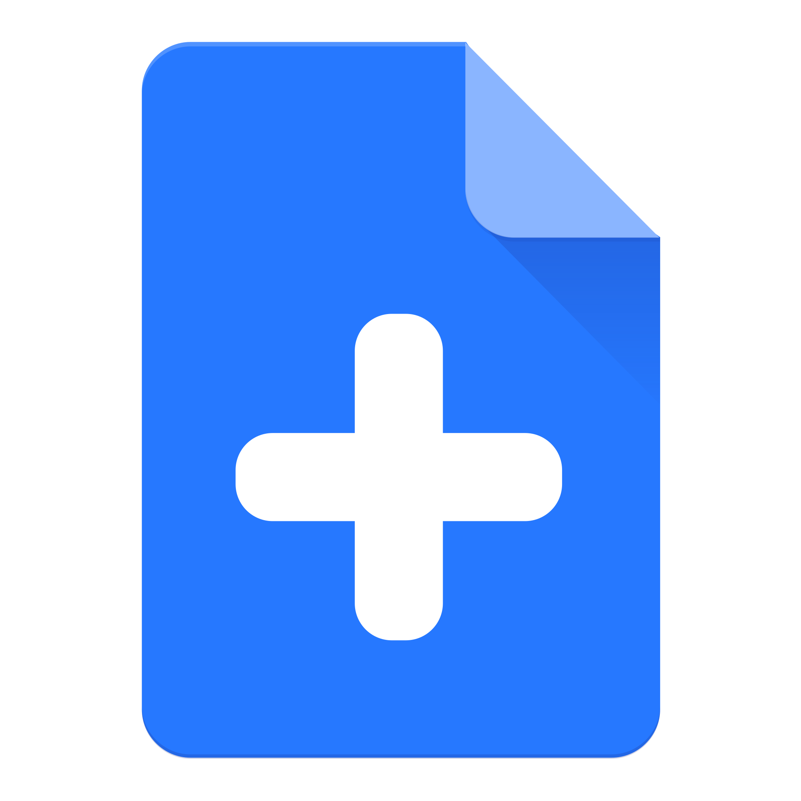
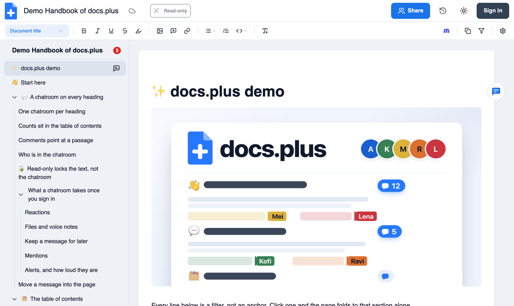

<p align="center">
  
</p>

<h1 align="center">docs.plus</h1>

<p align="center"><strong>Get everyone on the same page.</strong></p>

<p align="center">
  Shared documents with a chatroom on every heading.<br />
  The talk stays next to the text it is about. docs.plus is free and open source.
</p>

<p align="center">
  <a href="https://docs.plus"><strong>Try docs.plus</strong></a> ·
  <a href="https://docs.plus/demo">Demo</a> ·
  <a href="docs/README.md">Docs</a> ·
  <a href="docs/self-hosting/README.md">Host it yourself</a> ·
  <a href="extensions/README.md">Tiptap extensions</a> ·
  <a href="https://discord.gg/25JPG38J59">Discord</a>
</p>

<p align="center">
  <a href="https://github.com/docs-plus/docs.plus/releases"></a>
  <a href="LICENSE"></a>
</p>

<!-- Hero: recapture both files at the same paths. 1600 px wide, light and dark, signed in as the owner,
     one heading's chatroom open, counts in the table of contents. No "Read-only" chip and no "Sign in" button. -->
<a href="https://docs.plus">
  <picture>
    <source media="(prefers-color-scheme: dark)" srcset=".github/assets/editor-dark.png" />
    
  </picture>
</a>

## Try it now

Open [docs.plus](https://docs.plus) in your browser. There is nothing to install.

- **[Open a blank document](https://docs.plus/new).** You do not need an account. Write, and paste a link to a video or picture to embed it. Then send the link to your group.
- **[Take the tour](https://docs.plus/demo).** The demo has a section for each feature. You cannot edit its text, but many sections let you try the feature right there.
- **[Use it from your AI app](#use-it-from-your-ai-app).** Claude, ChatGPT, Cursor and other MCP apps can work in your documents.

Sign in with Google or an email link when you need more. You need an account to post, comment or react in a chatroom, and to upload, import or export files. You also need one to restore a version and to connect an AI app. Writing and printing do not need one.

## What you get

**A chatroom on every heading.** Ask a question under a section, and the answer stays with that section. Nobody has to guess which part you meant. On desktop, select a passage to comment on it, and the comment posts in that heading's chatroom. Reply in thread turns a message into a new heading. [Open a chatroom in the demo](https://docs.plus/demo/notifications).

**Find the busy sections.** The table of contents shows a message count beside each heading with messages. Sign in, and each count shows only what you have not read. On desktop, faces show who has each chatroom open, and you can drag a row to move its whole section. Drag it sideways to change its level. [Try it in the demo](https://docs.plus/demo/invisible).

**Send the exact view you mean.** Filter a document by a word, and it folds to the sections that contain it. The filter is part of the link, so you can send that view to someone. Here is [the demo, filtered to "spotify"](https://docs.plus/demo/spotify).

**Public by default, on purpose.** A new document is public, and anyone with the link can read and edit it. We kept this rule from Etherpad, where docs.plus began. Sign in before you first click into, type in or open chat in a new document, and it becomes yours. As the owner, you can make it Private or Read-only. A document you start signed out has no owner, so nobody can make it Private later.

**Catch up on what changed.** Open a document while signed in, and you follow it. Turn on email in Settings, and a digest shows what others changed, with the added and removed words under each heading. History lets you compare any two versions and restore one. [Compare versions in the demo](https://docs.plus/demo/versions).

### Use it from your AI app

Connect Claude, ChatGPT, Claude Code, Codex, Cursor, VS Code or any app that supports remote MCP. The app signs in as you, and it reads only the documents and chatrooms you can open. It can create documents, but it edits and posts chat only in documents you own. It never edits or removes an existing heading, and it never removes media. History marks each version an AI app wrote. [Set up your AI app](https://docs.plus/mcp) · [How to connect](docs/mcp/README.md)

### Also inside

| Write                                   | Share and keep                                   | On any device                                        |
| --------------------------------------- | ------------------------------------------------ | ---------------------------------------------------- |
| Live co-editing with presence           | Import `.docx` and `.md`                         | A phone layout, with the chatroom below the document |
| Mermaid diagrams drawn in the document  | Print or save as PDF, with no account            | Install it from the browser                          |
| Pictures, video, YouTube, Loom and more | Voice notes, reactions and mentions in chatrooms | Push and email alerts, with Quiet hours              |

## Host it yourself

docs.plus is MIT-licensed, and you can run it on your own server. It needs Docker, outside services such as Supabase and S3-compatible storage, and a paid license key for the chat list. Read [Self-hosting](docs/self-hosting/README.md) for the full list, then follow [Install](docs/self-hosting/install.md).

## Run the code on your computer

This path is for trying the code and for contributing. It is not a production setup. Install the [Prerequisites](CONTRIBUTING.md#-prerequisites) first.

```bash
git clone https://github.com/docs-plus/docs.plus.git
cd docs.plus
make dev-local
```

`make dev-local` sets up everything. It creates env files, installs dependencies, and starts PostgreSQL, Redis and a local Supabase. Then it starts the REST API, the WebSocket server, the worker and the webapp.

> [!NOTE]
> The first run downloads Docker images and takes several minutes. Later runs skip the downloads and start faster.

Then open <http://localhost:3000>. Sign in with a real email address: its domain must accept mail, so you need a network connection. Open the sign-in link in the local inbox at <http://127.0.0.1:54324>. No real mail leaves your machine. Google sign-in is optional; see [Turn on Google sign-in](docs/self-hosting/configuration.md#turn-on-google-sign-in).

<details>
<summary>All local addresses</summary>

- Webapp: <http://localhost:3000>
- REST API: <http://localhost:4000>
- WebSocket server: `ws://localhost:4001`
- Supabase Studio: <http://127.0.0.1:54323>
- Local email inbox: <http://127.0.0.1:54324>

</details>

If the first run stops, see [Development Setup](CONTRIBUTING.md#-development-setup). It covers the health check, stop and reset, the full-Docker path and Supabase Cloud.

## Tiptap extensions

The editor parts we build are open too. We publish six MIT [Tiptap](https://tiptap.dev) extensions on npm, and docs.plus runs on them in production. [Choose an extension](extensions/README.md#choose-an-extension), or see them all [on npm](https://www.npmjs.com/org/docs.plus).

```sh
npm install @docs.plus/extension-hyperlink
```

Or use `pnpm add`, `yarn add`, or `bun add` with the same package name.

## Documentation

Full documentation lives in [`docs/`](docs/README.md).

| I want to                            | Read                                                                                            |
| ------------------------------------ | ----------------------------------------------------------------------------------------------- |
| Call the API from my code            | [API overview](docs/api/README.md), then [Quickstart](docs/api/quickstart.md)                   |
| Use docs.plus from Claude or ChatGPT | [How to connect](docs/mcp/README.md), then the [MCP connector reference](docs/mcp/reference.md) |
| See what changed in each release     | [CHANGELOG.md](CHANGELOG.md) · [Releases](https://github.com/docs-plus/docs.plus/releases)      |
| See what is planned                  | [Roadmap](docs/roadmap/README.md)                                                               |
| Add a docs.plus badge to my README   | [Badges](docs/badges.md)                                                                        |

## Contributing

We are a small team, and every pull request helps. A typo fix is as welcome as a new feature. Start with the [contributing guide](CONTRIBUTING.md), and follow our [Code of Conduct](CODE_OF_CONDUCT.md).

**First contribution? Start here:**

- Run `make dev-local` from a clean clone. Then tell us where it was hard, in [#149](https://github.com/docs-plus/docs.plus/issues/149). Your notes make the first run easier for the next person.
- Pick an issue labeled [good first issue](https://github.com/docs-plus/docs.plus/issues?q=is%3Aissue%20is%3Aopen%20label%3A%22good%20first%20issue%22) or [help wanted](https://github.com/docs-plus/docs.plus/issues?q=is%3Aissue%20is%3Aopen%20label%3A%22help%20wanted%22).
- Planning a large change? Ask in Discord first, so we can tell you early whether the idea fits.

## Community and support

| Channel                                                                  | Best for                                                             |
| ------------------------------------------------------------------------ | -------------------------------------------------------------------- |
| [Discord](https://discord.gg/25JPG38J59)                                 | Chat with the team and other users                                   |
| [GitHub Discussions](https://github.com/docs-plus/docs.plus/discussions) | Questions and ideas                                                  |
| [GitHub Issues](https://github.com/docs-plus/docs.plus/issues)           | Bugs and feature requests                                            |
| [X: @docsdotplus](https://x.com/docsdotplus)                             | Follow the project                                                   |
| [contact@newspeak.house](mailto:contact@newspeak.house)                  | Anything else                                                        |
| [SECURITY.md](SECURITY.md)                                               | A security problem. Do not report it in a public issue or on Discord |

docs.plus is free to use, and a small team keeps it running. If it helps you, you can support us on [Patreon](https://www.patreon.com/docsplus).

The hosted service at docs.plus has a [Privacy policy](https://docs.plus/privacy) and [Terms](https://docs.plus/terms).

## Our story

docs.plus began as a fork of [Etherpad](https://github.com/ether/etherpad). We changed it to fit our needs, with plugins for section filtering, video chat on each heading and a mobile view. The idea of a chatroom on every heading comes from those years.

Etherpad struggled when many people worked in one long document, for example a hundred people at once. So in September 2022, after our last Etherpad-based tag, `v1.8.18`, we started again on [Tiptap](https://tiptap.dev), [ProseMirror](https://prosemirror.net) and [Yjs](https://yjs.dev). We owe a lot to Etherpad and its contributors, and we thank them.

docs.plus is a free and open-source project by [Newspeak House](https://newspeak.house), seed funded by Grant for the Web and Nesta. Hossein Marzban ([HMarzban](https://github.com/HMarzban)) maintains it.

**Built with** Bun, Next.js, React, Hono, Hocuspocus, Supabase, PostgreSQL and Redis. [Pele](https://pele.run) draws the Mermaid diagrams.

## License

[MIT](LICENSE) © 2023-2026 Hossein Marzban
