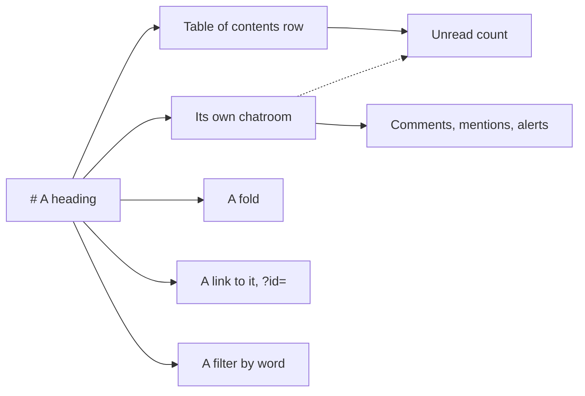
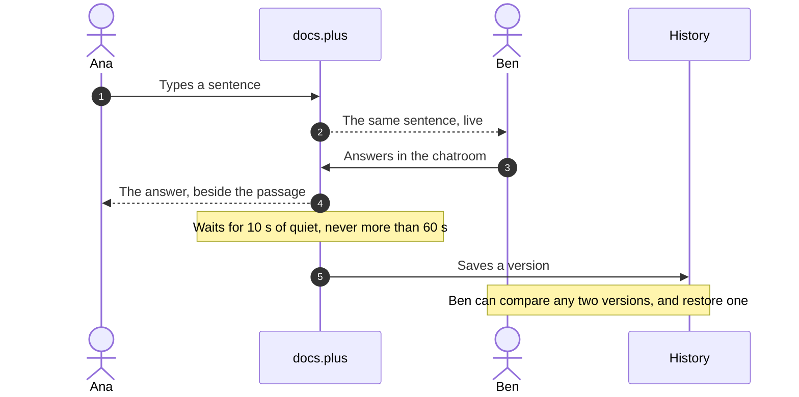
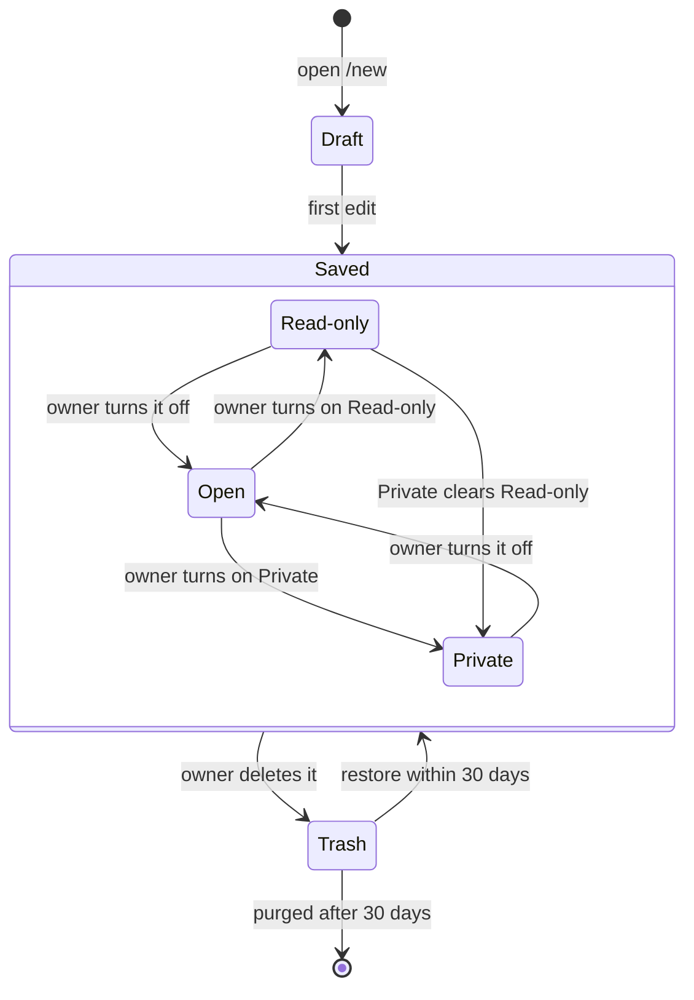
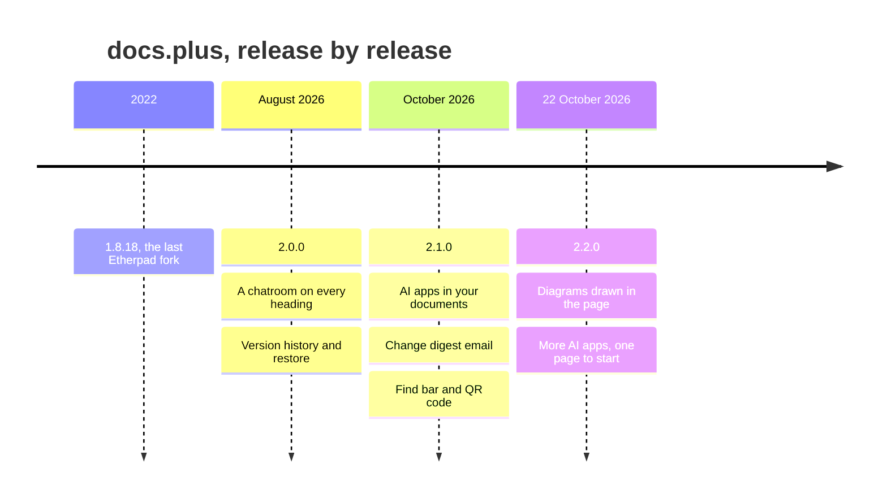
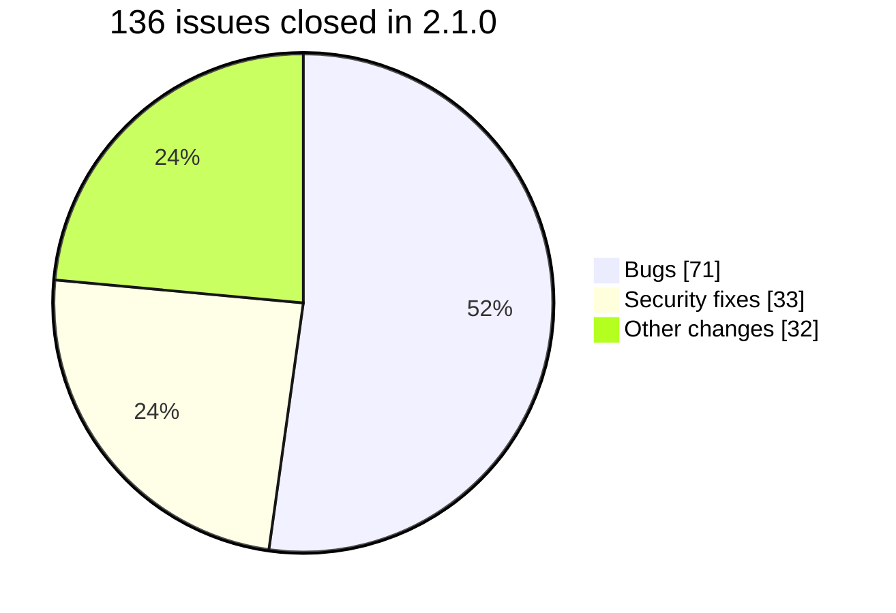
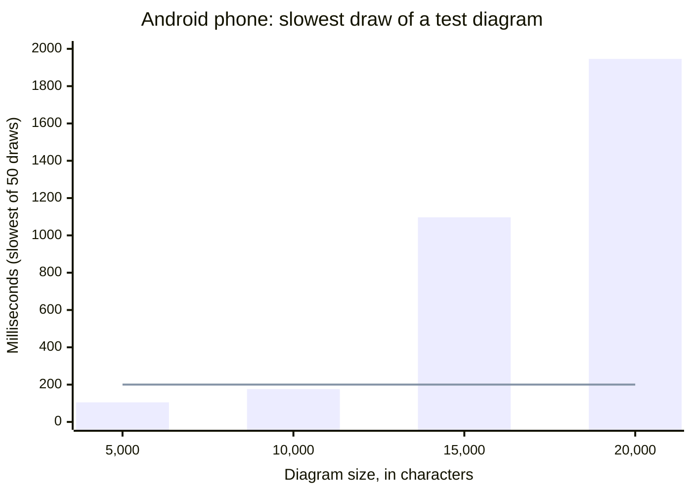
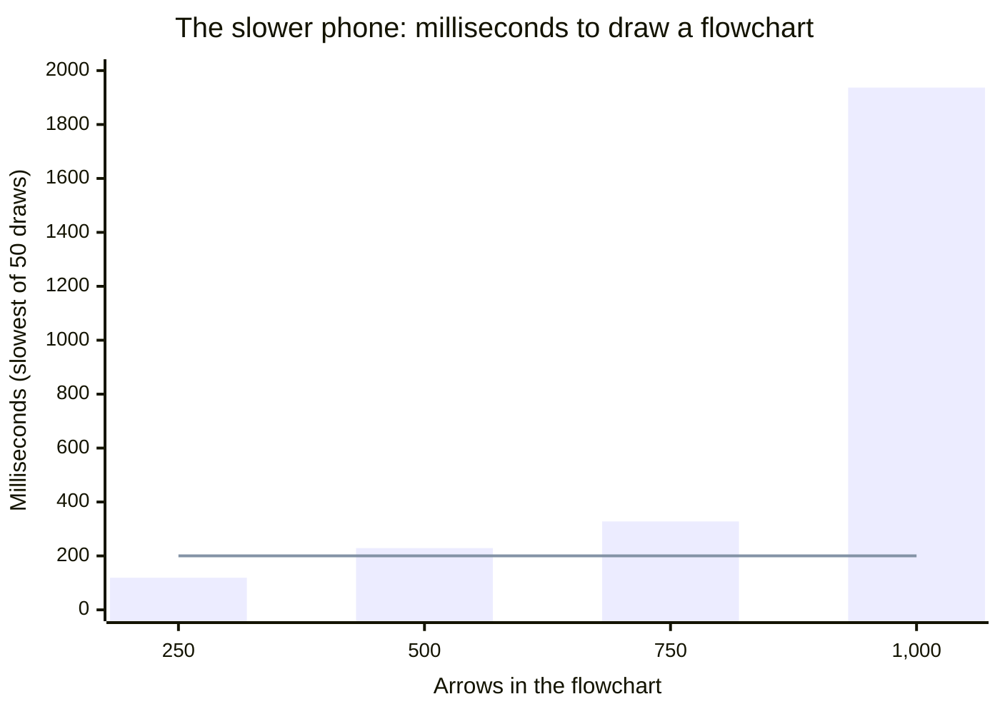
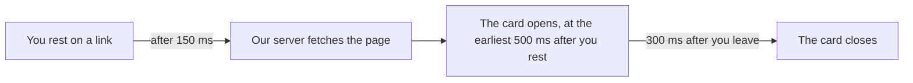

# ✨ docs.plus demo

docs.plus is a free, open-source shared document with ==a chatroom per heading==. The talk about a passage sits beside the passage, not in another app.

Nothing to install, and no sign-up to start. [/new](/new) opens a blank document you can write in.


**Click any line below, and the page folds to that part alone.** Each line is a filter, not an anchor.

- [👋 Start here](/demo/running)
- [💬 A chatroom on every heading](/demo/notifications)
- [🗂️ The table of contents](/demo/lights)
- [🔍 Filter by word](/demo/filter%20by%20word)
- [🧱 Why a section behaves this way](/demo/behaves)
- [🔗 Links](/demo/mailto)
- [🎬 Media](/demo/soundcloud)
- [✍️ Writing](/demo/writing)
- [📊 Diagrams](/demo/pele)
- [📜 What the history holds](/demo/snapshot)
- [📤 Import and export](/demo/import%20and%20export)
- [🔐 Who can open this document](/demo/owner-only)
- [🚀 Make your own](/demo/make%20your%20own)
- [🆕 What's new](/demo/released)

# 👋 Start here

docs.plus is a shared document where **every heading has its own chatroom**.

> **This page is docs.plus running**, not a picture of it.

Try the things it describes as you read them.

- **Talk here.** Open the chatroom on this heading from the chat button on its table of contents row — try it here.
- **Write your own.** This document is **read-only**. [/new](/new) opens a blank document you can write in.


_The chatroom for a passage sits beside the passage, not at the bottom of the page._

Filtered to this section? [Show the whole document](/demo).

# 💬 A chatroom on every heading

Every heading carries its own chatroom. The talk about a passage sits beside the passage, not at the bottom of the page and not in another app.

> A reply under a heading needs no quoted context. The passage is directly above it.

## One chatroom per heading

Messages posted under a heading **belong to that heading**. ==They show up nowhere else in the document.== There is no general channel they fall into.

- **Read it.** Open the chatroom on this heading, read it, and scroll back through it — try it here.
- **Find it.** On desktop, move the pointer anywhere over a section, and its heading's chat button shows beside the heading. Click it to open that chatroom — try it here.
- **Close it.** On desktop, drag the top edge of the docked chatroom down to close it. Let go below 160px and it closes. Let go between 160px and 320px and it returns to 320px — try it here.
- **Follow a reply.** A reply carries the message it answers: the author, the time, and a short run of it. Click that quoted block and the chatroom opens the message it came from — try it here.

A dated line separates the days. New messages, edits and reactions **arrive without a reload**.

Signed out, the composer opens the sign-in dialog instead of sending — needs an account.


_A reply quotes the message, not the page. The page is already above it._

## Counts sit in the table of contents

In the table of contents, a heading with messages swaps the chat button's icon for a count. The count means one of two things:

| You are    | The count is                                                                             |
| ---------- | ---------------------------------------------------------------------------------------- |
| Signed out | **The chatroom's total message count.** It counts every message, not the ones new to you |
| Signed in  | **Your own unread count.** Scrolling through the chatroom clears it — needs an account   |

It is the same badge, signed in or out.

## Comments point at a passage

A comment **carries the passage it is about**: an excerpt for text, a thumbnail for a picture or a video, framed in that media's colour.

Click the quoted block on a comment — try it here. The document scrolls to that exact run of text, not to the top of the section.

When the passage can no longer be found, the jump lands on the heading instead.

A comment starts in the document body. It posts into the chatroom of the heading that holds it — needs a document you can edit.

## Who is in the chatroom

On desktop, **a stack of faces sits on the table of contents row** of every heading whose chatroom someone has open. Hover a face for the name — try it here.

Signed in, a face also shows what that person is doing — needs an account.

| The face      | The person is          |
| ------------- | ---------------------- |
| Bounces       | Typing                 |
| Shows a smile | Choosing an emoji      |
| Shows a mic   | Recording a voice note |

- **Up to four faces** show on a heading row, then a count of the rest.
- ==The stack follows open chatrooms, not scroll position.== On a quiet document it stays empty.
- **Signed out,** you see other people and they do not see you. Your own face joins a row once you sign in — needs an account.


_A count means messages. A face means someone has that chatroom open._

## 🔓 Read-only locks the text, not the chatroom

The lock **stops at the document body**. Every chat control on this page still works:

- [x] The chat button on each table of contents row opens its chatroom.
- [x] The composer sends once you are signed in.
- [x] The message arrives for anyone who has that chatroom open.

> The text is fixed. The talk is not.

The table of contents has no drag grip and no Delete section here, because a locked page refuses both. Both need a document you can edit.

Open the chatroom on this heading and say what you would use a per-heading chatroom for — needs an account.

## What a chatroom takes once you sign in

**Everything under this heading needs an account.** This heading has sub-headings, so its table of contents row carries a chevron. Fold the section from that chevron to put it away — try it here.

### Reactions

Each emoji on a message is a _chip_, and reading a chip takes no account. A chip carries a number only when more than one person used that emoji. A single reaction shows the emoji alone.

Add a reaction — needs an account:

| On      | How                                                              |
| ------- | ---------------------------------------------------------------- |
| Desktop | The smiley in the hover menu opens the full picker               |
| Mobile  | A long press offers eleven one-tap emoji, and a `+` for the rest |

**A reaction chip is not a toggle.** On desktop, clicking a chip you are part of takes your own reaction back off, and it never adds one — needs an account.


_One tap answers, and the chatroom stays short._

### Files and voice notes

A chatroom takes what the page takes: images, video, audio, PDF, text, CSV, Markdown, JSON, Word, Excel, PowerPoint and ZIP.

| Limit                  | Cap       |
| ---------------------- | --------- |
| Size of one file       | 10 MB     |
| Files in one message   | 10        |
| Uploads at a time      | 3         |
| Length of a voice note | 5 minutes |

A voice note draws 24 live bars from the microphone as it records — needs an account.

On a phone, hold the mic to record — needs an account:

1. Hold the mic.
2. Slide up to lock, or slide left to cancel.
3. Let go to send.

A tap shows a hint and never sends.

An audio clip in a chatroom plays with seek, at 1×, 1.5× or 2× speed. Starting one clip pauses the others. A voice note sent from 2.1.0 on shows a 40-bar waveform and its length before you press play. Post a voice note to hear one — needs an account.

- **Pictures tile.** Two to ten pictures in one message lay out as a single tiled block. Click a tile for the full-screen gallery, and download from there — try it here.
- **Spoilers blur.** An image can be sent as a spoiler, blurred until the reader taps it. Video and audio cannot — needs an account.


_A chatroom takes what the page takes, inside a fixed set of caps._

### Keep a message for later

A bookmark saves a message to your own list, and a second tap takes it back off. The message keeps a Bookmarked tag in the chatroom — needs an account.

The list opens from the bookmark icon in the document toolbar, in three tabs: in progress, archive, and read.

View on a row opens that heading's chatroom at the message — needs an account.


_The message keeps a tag. The list keeps the message._

### Mentions

Type `@`, then pick a name, to tell that person about the message. `@everyone` tells the whole chatroom — needs an account.

| How you write the name    | Who it reaches                                                      |
| ------------------------- | ------------------------------------------------------------------- |
| You pick it from the list | That person, even after they rename                                 |
| You only type it          | That person, only when what you type **matches the whole username** |

So `@harvey` does not reach `harvey_marzban`, and `@everyone_team` does not fire `@everyone`.

A mention in a message is coloured and tappable. Tap it for that person's profile card — try it here. On your own empty card, Add bio and links opens Settings on Profile.


_A typed name matches in full, or sends no alert._

### Alerts, and how loud they are

A bell in the document header holds the list: mentions, replies, reactions, thread messages, channel events, direct messages, invitations and system alerts. The bell is hidden until you sign in.

View on a row opens that heading's chatroom at the message, and Mark all read clears the list — needs an account.


_Tap View. Land on the message._

Every heading has its own chatroom, so **every heading has its own level**. One bell in the chatroom header cycles through three levels:

1. All notifications
2. Mentions only
3. Muted

There is no menu — needs an account.


_Mute one section and keep the next one loud._

## Move a message into the page

Two message controls carry talk into the document:

| Control         | What it does                                                                                                                                                                                                    |
| --------------- | --------------------------------------------------------------------------------------------------------------------------------------------------------------------------------------------------------------- |
| Copy to doc     | **Writes the message into the document**, under the heading that owns the chatroom. The line it leaves is dated and links back to the message. The message's files come with it — needs a document you can edit |
| Reply in thread | Does the other half. It **turns a message into a new heading** in the document, then opens that heading's chatroom — needs a document you can edit                                                              |

Both controls stay visible on this page, and the server refuses both writes.

Copy link on a message works here. It puts a link to that message on your clipboard, and its icon turns into a check — try it here.


_Say it in the chatroom, keep it in the page._

Filtered to this section? [Show the whole document](/demo).

# 🗂️ The table of contents

Every heading in this document **gets a row in the table of contents**, at its own level, in document order.

- **Scroll the page,** and the row you are reading lights up.
- **The table of contents scrolls itself,** so that row stays in view.
- **Click a row,** and the page scrolls to that heading — try it here.


_One row per heading. Fold from a row, and the page creases where the text went._

## What lands in a row

A row carries the level of the heading and the text you typed. A heading with no text still **gets a row**. The row shows the page's grey hint, such as "Heading 2" — needs a document you can edit. ==So the table of contents always matches the page.==

The table of contents has its own column. Drag the divider between that column and the page to resize it — try it here.

- **Width.** It runs from 240px to 46% of the column and page together.
- **Memory.** Your browser remembers a width above 240px.
- **Input.** That gesture needs a mouse.

Drag the divider below 120px, and the column turns into the **tick rail**: a 32px strip with one tick per heading. The docked chatroom then spans the full width — try it here.

| On the rail                                    | What it does               |
| ---------------------------------------------- | -------------------------- |
| Hover or focus a tick                          | Opens its section card     |
| Click a tick                                   | Jumps to that section      |
| The button at the top of the rail, or a reload | Brings the full table back |

The section card has a chat button that opens that heading's chatroom. Tab moves into the card, and Escape leaves it — try it here. A video or an embed never plays in the card.

## The row's menu

**Right-click a row for its menu** — try it here. This page shows four entries:

| Entry         | What it does                                                                                     |
| ------------- | ------------------------------------------------------------------------------------------------ |
| Chat room     | Opens the chatroom on that heading                                                               |
| Fold section  | Folds it. On a folded row, it reads Unfold section                                               |
| Focus section | Writes the heading text into the address as the only filter term                                 |
| Copy link     | Puts a link to that heading on your clipboard. The copied link scrolls there on a cold page load |

Paste the copied link into a rich text editor, and its text names the heading and the headings above it, like a breadcrumb. It never carries the filter or the chatroom you have open — try it here.

On a focused row, Shift+F10 or the Menu key opens the same menu — try it here.

A document you can edit adds a fifth entry, **Delete section**. ==It removes the whole section, body text and media with it.== It asks you to confirm first.

The menu is desktop only. The document title row at the top has none.

## Folding

The chevron on a row folds its section — try it here. Body text, media and sub-headings hide, and **the page creases where they were**. The crease is sized by what it covers: two strips for a short section, up to four for a long one. Click a crease in the page to unfold it — try it here.

- **A heading with sub-headings** shows the chevron. Only these headings get one.
- **A heading with body text alone** folds from its right-click menu. `📜 What the history holds` is one of those — try it here.

> A fold changes no text. It is drawing, not editing, which is why it works on this locked page.

Your folds are kept per document, in your own browser. Reload, and the page comes back creased where you left it. ==Nobody else sees them.==

A filter folds sections for you. It saves your own folds first, and puts them back when you clear the filter.

A link to a heading lands on it, even when a fold or a filter hides it. It opens only the sections that hide the heading, then scrolls the heading to the top. Those sections stay open for this visit only. Your saved folds do not change, so a reload folds them again.

## Moving a section

Drag the grip on a row up or down, and let go between two rows — needs a document you can edit. Where you let go sets what happens:

| Where you let go       | What happens                                                                                                          |
| ---------------------- | --------------------------------------------------------------------------------------------------------------------- |
| Between two rows       | The slot sets the level. The section joins the list where the line sits, and the rail of the list it joins turns blue |
| On the middle of a row | The section goes inside that row, as its last sub-section                                                             |
| Where it started       | Nothing changes                                                                                                       |

The first line, the title, has no grip, and nothing can land above it.


_The slot sets the order and the level. The whole section travels._

**The whole section travels**: the heading, its body text, its media, and every sub-heading under it. ==One undo step puts it back.==

- Every sub-heading shifts by the same number of levels as the dragged heading, and stops at H6.
- A move never pulls the headings that follow into the section.

A cut and paste inside the same page keeps each heading's chatroom and every link to it — needs a document you can edit. A paste from another page or another site gives the headings new ids, so they start new chatrooms.

The grip is desktop only.

Filtered to this section? [Show the whole document](/demo).

# 🔍 Filter by word

Open [/demo/spotify](/demo/spotify). The page folds down to the two sections that hold the word, and every hit is marked where it sits — try it here.

**The path after the document name is the filter.** Nothing else holds that state.


_Two terms in the address, and the page folded down to what matches._

How a match works:

- **What stays open.** A section stays open when the word appears in its own text: the heading, plus the body under it, down to the next heading. Its parents stay open with it, and so does everything nested beneath it.
- **Case.** The match is a plain run of letters, and it ignores case. So `fold` also finds `folding` and `unfold`.
- **Gaps.** A run of spaces, tabs or hyphens counts as one gap, so `customer-research` finds `customer research`.

Two things follow. A term that matches a heading always keeps that section, so every section name on this page works as a filter. And ==the filter reads text, not subject matter==.

One of the two sections `spotify` keeps is `▶️ Embeds`. The other is this one, because the word sits here too.

**Every word in this document** is a filter term. Try [/demo/account](/demo/account) next. It keeps every claim that needs one, and this section again.

You do not have to use the links above. The **filter button in the toolbar** opens a search box — try it here:

1. Press the filter button. The search box opens.
2. Type any word on this page. The box counts the matching sections as you type, and the rest fold away.
3. Whatever you type becomes the address, so you can hand that view to someone else.

## Either word, or both

| Link                                                 | Mode                    | Keeps                                    |
| ---------------------------------------------------- | ----------------------- | ---------------------------------------- |
| [/demo/fold/drag](/demo/fold/drag)                   | `?mode=or`, the default | A section that holds either word         |
| [/demo/fold/drag?mode=and](/demo/fold/drag?mode=and) | `?mode=and`             | **Only a section that holds both words** |

Naming `?mode=or` changes nothing, because it is the default. The `and` result is always a subset of the `or` result, because an intersection cannot return more.

Two sections hold both words: this one, and `A section is a range`. Their parent headings stay open above them.

## The URL is the state

Active terms sit beside the title as chips:

- **Each chip** carries an × that drops that one term — try it here.
- **Reset** sits beside the chips. It clears every term and the mode with it. On desktop it fades in when you hover the row.

> Copy what is in the address bar, and you have handed someone **the view itself, not a description of it**.

## Find, without folding

On desktop, press ⌘+F (Ctrl+F). The **Find bar** opens at the top right of the page — try it here. It counts the matches, such as 3 of 12.

| Key or button                    | What it does              |
| -------------------------------- | ------------------------- |
| Previous, Next, ⌘+G, ⌘+⇧+G or F3 | Steps through the matches |
| Escape                           | Closes the bar            |

How it differs from the filter:

- **The filter** folds away what does not match.
- **Find** keeps the whole page and steps through it. A match inside a folded section opens that section, then folds it again when you move on.

On a phone, Find is a docked row, and the table of contents drawer offers it too.

Press ⌘+⇧+K (Ctrl+Shift+K) for the jump list — try it here. On this page it offers History, Filter, Find in document, New document and Demo. Type to narrow the list. Your Settings, alerts and documents join it once you sign in — needs an account.

Filtered to this section? [Show the whole document](/demo).

# 🧱 Why a section behaves this way

> Every heading opens a section.

Folding, the table of contents, the filter, and the chatroom on a heading **all key off that one fact**.

## A section is a range

A section is not a container you put text into. It is a _range_ the editor computes. ==It runs from a heading to the next heading at the same level or above it.== When there is none, it runs to the end of the document.

Underneath, **the document stays flat**: one list of blocks, with nothing nested inside anything.


_A section is a span the editor computes over one flat list of blocks._

That range is the unit the rest of the product acts on:

- **The table of contents row** stands for it.
- **A fold** hides it.
- **A filter** keeps it or drops it.
- **A drag** carries it.

## 📐 Size comes from rank

Heading size is **computed, not chosen**. Nothing in the markup says 18pt.

1. Take the headings from one `#` to the next `#`. The document title takes no rank.
2. Collect the distinct levels among them, in order.
3. Give the first 24pt, the last 14pt, and space the rest evenly between.

| Distinct levels | Sizes, in points            | Step between ranks |
| --------------- | --------------------------- | ------------------ |
| 1               | 24                          | —                  |
| 2               | 24 · 14                     | 10                 |
| 3               | 24 · 19 · 14                | 5                  |
| 4               | 24 · 20.67 · 17.33 · 14     | 3.33               |
| 5               | 24 · 21.5 · 19 · 16.5 · 14  | 2.5                |
| 6               | 24 · 22 · 20 · 18 · 16 · 14 | 2                  |

The block that holds this heading is the proof. It starts at `🧱 Why a section behaves this way` and ends at the next `#`. That block uses two levels, so its sizes are 24pt and 14pt. This heading is a `##`, so it renders 14pt.

Now take the block that starts at `💬 A chatroom on every heading`. It uses three levels, so a `##` inside it renders 19pt. Same tag, different size, because ==size answers how deep a heading sits inside its own block==.

Filtered to this section? [Show the whole document](/demo).

# 🔗 Links

Click a link on this page and a card opens under it, naming what sits on the other end — try it here. Going there takes a second click, on the card.

> You see where a link leads **before you commit to leaving**.

## An icon on every link

Most links on this page start with a small icon that shows where they go — try it here.


| A link to              | Shows                                                            |
| ---------------------- | ---------------------------------------------------------------- |
| The web                | Its site's favicon                                               |
| Another docs.plus page | The docs.plus logo                                               |
| Mail or a phone        | A mail or phone icon. This page holds none                       |
| This page              | What it opens: a heading, a chat, a filter, a version or the top |

So every line of the contents list at the top carries the filter icon.

The icons come through our own server, never straight from the linked site. A site with no icon keeps a plain link. In print, a link shows no icon.

## Rest on a link

On desktop, rest the mouse on a link and a card opens after half a second, with no click — try it here. ==Our server fetches the card, so your browser sends nothing to the linked site.==


| When                                 | What happens                                                                      |
| ------------------------------------ | --------------------------------------------------------------------------------- |
| 150 ms after you rest                | The card asks for its content. So a pointer that passes over a link costs nothing |
| Half a second after you rest         | The card opens                                                                    |
| The page is slow                     | The card opens with grey bars. The content then replaces them in the same card    |
| 4 seconds with no answer             | The card shows the address and says the site shares no preview                    |
| 300 ms after you leave link and card | The card closes                                                                   |

The last line of the card holds:

- **Copy link**
- **Open in new tab**
- **Use page title**, when a link's text is its own address — needs a document you can edit

Shift, the arrow keys and Copy keep the card open. Any other key closes it.

Settings › Appearance › **Link previews** has three switches — needs an account:

- **Show link previews on hover**
- **Use page titles for pasted links**
- **Use pad titles for pasted pad links**

A touch screen has no hover, so a tap opens the click card instead.

## Out to the web

[https://github.com/docs-plus/docs.plus](https://github.com/docs-plus/docs.plus) is an ordinary external link. Rest on it, and its card shows the page's picture, title and description — try it here.

Some sites add more to the card:

- **GitHub.** Some public GitHub projects add the stars, the main language and the last update, as [ueberdosis/tiptap](https://github.com/ueberdosis/tiptap) shows — try it here.
- **Stack Overflow.** A question shows its answer count. It adds **Accepted answer** when one is accepted: [Why is conditional processing of a sorted array faster than of an unsorted array?](https://stackoverflow.com/questions/11227809/why-is-processing-a-sorted-array-faster-than-processing-an-unsorted-array) — try it here.
- **Wikipedia.** An article shows its opening lines, and its lead picture when it has one: [Collaborative real-time editor](https://en.wikipedia.org/wiki/Collaborative_real-time_editor) — try it here.
- **Job posts.** A job post shows where the job is, how it is worked, and when it was posted.

Click a link, and its card fills with **the page title and the site icon, held for 5 minutes**. Copy link sits on the card, and its icon turns into a check when the copy works — try it here. On desktop, Edit and Remove sit there too, but only on a document you can edit.

The card's title is itself a link, so one click on the title goes there — try it here. When the fetch fails, that title falls back to the raw address, and the link still works.

| You do this                            | What happens                                                    |
| -------------------------------------- | --------------------------------------------------------------- |
| ⌘-click (Ctrl-click) or a middle click | Skips the card and opens the link in a new tab — try it here    |
| Enter on a focused link                | Opens its card, even on this page                               |
| ⌘+K (Ctrl+K), caret inside a link      | Opens its card — needs a document you can edit                  |
| Escape, in that card                   | Takes you back to the same spot — needs a document you can edit |
| Alt+Enter, caret inside a link         | Opens the link — needs a document you can edit                  |

On a document you can edit, a link shows the hand cursor only while you hold ⌘ or Ctrl. On this page, links always show it.

## When a page shares nothing

Some sites refuse to share a preview. Then the card puts the address first:

- The site name is the title.
- The full path wraps under it.
- The last line says why there is no preview.

[The New York Times](https://www.nytimes.com/) does not share previews — try it here. When the site blocked us or did not answer, the card also offers **View archived copy**. One click asks the Internet Archive for a saved copy, then shows a link that opens it.


Two more kinds of link change the card:

- **A link to a file.** The file name is the title, and [a sample PDF](https://www.w3.org/WAI/ER/tests/xhtml/testfiles/resources/pdf/dummy.pdf) says it is a PDF file — try it here. The card knows PDFs, documents, spreadsheets, slides, archives, pictures, audio and video.
- **A link that names one site but opens another.** ==The card warns you.== This link reads [github.com](https://github-login.example.net/session) but opens another site — try it here.

On mobile the card is a bottom sheet instead. Its four rows are Open link, Copy link, Edit link and Remove link. The first two work with no sign-in — try it here.

## Paste a link, get its name

Copy a web address and paste it into a document. The link takes **the page's title** in place of the long address — needs a document you can edit.

1. Open a page from [/new](/new).
2. Paste [https://github.com/docs-plus/docs.plus](https://github.com/docs-plus/docs.plus) into it. The address shows at once.
3. The title replaces it when our server answers, usually within a second.
4. One undo brings the address back, and a second removes the paste.


| You paste                        | The link reads                                                      |
| -------------------------------- | ------------------------------------------------------------------- |
| With ⌘+⇧+V (Ctrl+Shift+V)        | The address as it is                                                |
| A file link                      | Its file name and format, so the sample PDF above reads `dummy.pdf` |
| A link to another docs.plus page | That page's title                                                   |
| A heading link                   | Like `Budget · Q3 launch plan`                                      |
| A link to a Private page         | Its address                                                         |
| Any link, in a chatroom          | Its address                                                         |

==A title can never pose as another site.== A page titled `paypal.com` that lives anywhere else keeps its address.

Settings › Appearance › **Use page titles for pasted links** turns it off, and **Use pad titles for pasted pad links** does the same for docs.plus links — needs an account.

## Built on an open extension

The hover cards and the pasted titles both come from our open-source Tiptap extension, [@docs.plus/extension-hyperlink](https://github.com/docs-plus/docs.plus/tree/main/extensions/extension-hyperlink). Any Tiptap editor can use them, and both stay off until a developer turns them on.

- `hovercard` takes your own preview service. It brings the timing, the keys and the card frame, and you can draw your own card inside it. Guide: [Hovercard](https://github.com/docs-plus/docs.plus/blob/main/extensions/extension-hyperlink/docs/hovercard.md).
- `pasteTitle` takes your own title service. It brings the undo step, the raw paste and the title cleaning. Guide: [Paste title](https://github.com/docs-plus/docs.plus/blob/main/extensions/extension-hyperlink/docs/paste-title.md).

Both ship in the next npm release of the extension.

## Addresses that are not web pages

A `mailto:` or `tel:` link has no page to fetch. The address becomes the title, and the icon names the kind. The pad maps **47 schemes** this way: mail, phone, maps, video calls, and app links.

## Back into the document

==A link into this document never touches the network.== It resolves on the spot, and its click card shows a destination chip. The chip names the place: **This document**, a quoted heading, a chat or a message, **Filtered view**, or **Version N**.


[/demo/crease](/demo/crease) is such a link. Its card carries a **Filtered view** chip, with **Match any** and one pill for each term. Click the chip and the page folds in place — try it here. No reload, and no new tab.

A [/new](/new) link gets a chip of its own, **New document**. Click the chip, and a blank document opens in a new tab.

## Cards for docs.plus pages

Rest on a link to a docs.plus page, and its card comes from the page itself, not from a scraped preview. It names the page, the headings above the target, and what sits there. A filter or a heading in this page reads the open page, so it asks the server nothing.

- **A filter.** [/demo/crease](/demo/crease) shows **Filter for “crease”**, how many sections the filter shows, and the first two. Every filter link on this page has a card like it — try it here.
- **A heading.** [Folding](/demo?id=HoKBe56adb5466L6) shows the heading, the headings above it, its subsections and its first lines — try it here.
- **A chatroom.** [The chatroom on Start here](/demo?chatroom=6adb5466z7HG78l0) shows how many messages it holds — try it here. ==A card shows counts and dates only, never a message or a name.==
- **History.** [This page's history](/demo#history) shows how many versions the page keeps, and the last save.
- **A version.** [Version 1](/demo#history?version=1) shows when that version was saved — try it here.
- **A Private page.** Its card shows only **This document is private**. Its title and text stay hidden from everyone but its owner.

To see a heading link open a fold:

1. Fold `🗂️ The table of contents` first.
2. Click the Folding link, then its chip.
3. The page opens that fold and lands on the heading — try it here.

Filtered to this section? [Show the whole document](/demo).

# 🎬 Media

**Nine kinds of media** sit in the body text: pictures, uploaded video, uploaded audio, and six embed providers.

## Images

A picture sits **in the run of the text**, not in a gallery beside it.

- **While a remote picture loads,** a grey shell holds its place.
- **A picture that fails to load** says so, and names the site it comes from.

Hover a picture and its toolbar appears — needs a document you can edit. The toolbar checks edit rights first, so this page shows the pictures and no toolbar.

With that toolbar up, eight handles ring the picture. The four side ones change one axis. The four corner ones change both axes, and they always keep the shape — needs a document you can edit.

Nothing goes below 160px wide or 80px high.

## Video and audio

An uploaded file plays where it sits. Press play on the video and then on the audio below it — try it here.

[/demo-assets/demo-video.mp4](/demo-assets/demo-video.mp4)

[/demo-assets/demo-audio.mp3](/demo-assets/demo-audio.mp3)

_Clip credits: the video is Big Buck Bunny, © Blender Foundation, CC BY 3.0. The audio is Example.ogg from Wikimedia Commons, CC BY-SA 3.0._

Neither is built by pasting an address, the way the embeds are:

- **Both arrive through the insert panel** — needs a document you can edit.
- **A file uploaded there** can be up to 10,485,760 bytes.
- **The upload needs an account.**

## ▶️ Embeds

Six providers **render in place rather than as links**: YouTube, Vimeo, Loom, SoundCloud, Spotify, and X.

==Paste a provider address into the body and the player is built on the spot== — needs a document you can edit. No menu, and no dialog.

Two providers set their own size rules:

- **X.** An X post has no drag grip. Its width comes from presets instead — needs a document you can edit.
- **Spotify.** A Spotify player will not go under its own height. A single track floors at 152px, and every other kind floors at 352px.

<https://www.youtube.com/watch?v=aqz-KE-bpKQ>

<https://vimeo.com/76979871>

<https://www.loom.com/share/e5b8c04bca094dd8a5507925ab887002>

<https://soundcloud.com/forss/flickermood>

<https://open.spotify.com/track/11dFghVXANMlKmJXsNCbNl>

<https://x.com/jack/status/20>

Filtered to this section? [Show the whole document](/demo).

# ✍️ Writing

> Formatting shows a reader which decisions matter.

Type `/` on an empty line for a list of blocks to insert, from headings to pictures — needs a document you can edit. Try it in [/new](/new).

## Marks that mean something

Reach for a mark when it changes meaning, not when a sentence feels flat. Each sentence below wears the mark it describes.

**Bold names a thing, or the key claim in a sentence.** _Italic marks a term or a title._ ~~Strikethrough keeps the record when a decision moves.~~ ==Highlight marks the one line a reader must see first, once a section at most.==


_Bold, italic, strikethrough, highlight: four marks, four jobs._

- **Keys.** Each mark has a toolbar button and a key — needs a document you can edit. The keys run from ⌘+B (Ctrl+B) for bold to ⌘+⇧+H (Ctrl+Shift+H) for highlight.
- **Markdown.** Highlight also survives Markdown, as `==text==`.
- **Clear formatting,** or `⌘+\` (`Ctrl+\`), takes the marks off and keeps headings and links — needs a document you can edit.

There is a fifth mark, <u>underline</u>, and it is the one to reach for least. On a page full of links, an underlined word claims to be one. In Markdown it travels as `<u>text</u>`.

## Code stays code

Inline code sets **a flag, a path, or a value** apart from the prose: `--frozen-lockfile`, `mode=and`, `heading-scale.ts`. Type a backtick pair, or press ⌘+E (Ctrl+E) — needs a document you can edit.

For anything longer than a phrase, use a fenced block and name the language:

| Name the block                                                             | The pad                                          |
| -------------------------------------------------------------------------- | ------------------------------------------------ |
| `html`, `css`, `js`, `ts`, `markdown`, `python`, `yaml`, `json`, or `bash` | Colours it. It colours **exactly nine**          |
| `mermaid`                                                                  | Draws it instead — see [📊 Diagrams](/demo/pele) |

```bash
bun run --filter @docs.plus/webapp dev
```

Filtered to this section? [Show the whole document](/demo).

## Lists, quotes and rules

Three kinds of list, and the choice carries meaning. Pick the one that matches the thing.

A **bullet list** holds items with no order. Reordering it changes nothing.

- A heading opens a section
- A section is a range
- A range is what folds

A **numbered list** holds steps that run in order. Reordering it breaks the instructions.

1. Open a heading from its table of contents row
2. Read what is under it
3. Answer in the chatroom beside it

A **checkbox list** tracks work that is not finished. A tick is saved for everyone reading — needs a document you can edit.

- [ ] Seed the chatrooms with a real conversation
- [ ] Draw the version history picture
- [x] Put every illustration in the page

A **quote** sets words apart from your own.

> A section is not a container you put text into. It is a range the editor computes.

Type three dashes (`---`) and the editor draws a rule across the page — needs a document you can edit.

---

A rule ends a passage. It carries no text, so a filter never keeps a section for it.

# 📊 Diagrams

Write a diagram as text, and docs.plus draws it under the text. ==Every diagram below is drawn live in your browser==, not pasted as a picture.


_The text is the diagram. Change a word and the picture follows._

- **The language.** Mermaid, the diagram language GitHub and Obsidian read.
- **The renderer.** Pele, the small Mermaid renderer by Steph Ango, CEO of Obsidian.
- **The kinds.** Flowcharts, sequences, states, timelines, pie charts and more all work.

Start one in either of two ways — needs a document you can edit:

- Type `/diagram` on an empty line.
- Pick **Diagram** from the Code menu.

Either way you get a small example to change. Try it in [/new](/new).

On this read-only page each diagram starts with its text folded away. Hover a diagram for three buttons — try it here.

| Button          | What it does                  |
| --------------- | ----------------------------- |
| **Syntax**      | Opens the Mermaid reference   |
| **Copy**        | Copies the text               |
| **Show source** | Opens the text, so you see it |

Your choice is yours alone, and this browser remembers it.

Each diagram below sits under its own heading, so each one has its own chatroom — try it here.

## How a heading becomes a room

Start at one heading on the left, and follow each arrow to what it gives you.



One heading gives you **five things at once**. The rest of this page shows each of them.

## Two people, one page

Ana types, and Ben answers. Read the steps from top to bottom.



Edits reach everyone at once. ==History keeps a version after 10 seconds of quiet, and never waits more than 60.==

## A document's life

A document can move through these states, from a new draft to Trash.



- **Private** and **Read-only** belong to the owner.
- Only one of them is on at a time.
- **Trash** keeps a document for 30 days.

## From Etherpad fork to diagrams

Each step on this timeline is one release, from the last Etherpad fork to 2.2.0.



## 2.1.0 in one picture

Each slice is one kind of issue that 2.1.0 closed.



## Measured on real phones

How big may a diagram be before it slows a phone down? We did not guess. This is how we measured it:

- **Devices.** A real Android phone and a real iPhone.
- **Runs.** We drew test diagrams of each size 50 times.
- **When.** On 21 October 2026, with Pele 1.7.0.
- **Score.** For each size, we kept the slowest draw of the slowest test diagram.

==Our budget is 200 ms, the orange line.== Every bar above it failed.

The first chart grows the text, on the Android phone.



At 10,000 characters the phone stays under budget. At 15,000 the slowest draw took **1.1 seconds**, more than five times the budget. So a diagram stops at **10,000 characters**.

The second chart grows the arrows in a flowchart, on the slower phone.



Arrows cost more than text. Both phones went over budget at 500 arrows, so a diagram stops at **250**.

The table puts all three devices side by side. A bold time is over budget.

| Size              | Mac   | iPhone     | Android      |
| ----------------- | ----- | ---------- | ------------ |
| 10,000 characters | 25 ms | 94 ms      | 176 ms       |
| 15,000 characters | 37 ms | 132 ms     | **1,097 ms** |
| 250 arrows        | 21 ms | 119 ms     | 119 ms       |
| 500 arrows        | 37 ms | **229 ms** | **202 ms**   |

A Mac drew even a 20,000-character diagram in 51 ms.

> The phone in your pocket is the real test.

These two charts are drawn live by Pele too, from six lines of text each.

## When a diagram goes wrong

docs.plus answers each kind of trouble in its own way.

- **A mistake.** It shows one second after you stop typing, with the line it is on. The last good drawing stays on screen, faded, so the page never jumps — needs a document you can edit.
- **Too big.** A diagram over 10,000 characters or 250 arrows is not drawn, so a big one never freezes a phone. We measured that limit on a real iPhone and a real Android phone. The message names the limit it hit and the count, and asks you to split it.
- **From an AI app.** A connected AI app can write diagrams too. docs.plus checks each one before the write, and refuses one that does not parse or is too large — needs an account.

History, print and dark mode all show the drawn diagram. Markdown export keeps the text as a `mermaid` block, so a diagram survives the trip out and back.

Filtered to this section? [Show the whole document](/demo).

# 📜 What the history holds

Every save is **a whole snapshot of the document**, with a rising version number. Typing is saved after 10 seconds of quiet, and forced after 60 seconds when you keep going.

Open the history from the clock button in the document header. A public document does not need an account to read it.

- **Sessions and days.** Versions arrive grouped into _sessions_, then into days titled Today, Yesterday, or a date. A session breaks after a gap of two minutes.
- **Faces.** A row carries the faces of the people in that version.
- **Badges.** A row also carries a badge naming where the version came from: API, Checkpoint, Restored, Pre-restore, Migration, or Connected app. Connected app marks a version that an AI app wrote. An ordinary live save gets no badge.
- **The newest 50.** The list shows the newest 50 versions. When a document has more, Show older versions loads the next 50.


Click a version and it renders in a read-only editor, so ==reading an old draft changes nothing==. Heading chat is hidden while you read one. Inside the view you can compare two versions, copy a link to one, and print the one you are reading.

| In the view                                                  | How it shows                                     |
| ------------------------------------------------------------ | ------------------------------------------------ |
| Added text, in Compare                                       | Marked inline                                    |
| Removed text, in Compare                                     | Kept as struck-through text                      |
| A change to formatting only, such as bold or a heading level | An edge on its block                             |
| The authors panel                                            | Each block coloured by whose text sits there now |

**Restore puts an old version back for everybody.**

- It is offered only to a signed-in writer, and only on a version that is not the latest.
- A visitor never sees the control.
- A restore writes a safety copy of the current text first. That copy carries the Pre-restore badge.

After 30 days, old automatic saves are thinned to one per day. Each day's newest save survives. A version you named yourself is never thinned.

> The history can name who wrote a run of text. It can **never name who deleted one**.

A restore, an import, or an API write carries no author, so the badge names the operation instead.

A signed-in rename of the Pad title posts a notice in the document chat. History paints the latest of those notices above the editor. That notice is not a version. A signed-out rename posts nothing.

Signed in, you **follow** a document when you open it. Turn on email in Settings, and edits by other people arrive as a **change digest** email. It marks added and removed words under each changed heading — needs an account.

Turn Follow off in Document settings to stop that mail. In the alert list, View on a document change opens History with compare already open — needs an account.

Filtered to this section? [Show the whole document](/demo).

# 📤 Import and export

**Take a document out as PDF, Word, Markdown or OpenDocument, and bring Word or Markdown back in.** The gear button opens Document settings. Its Import & export section holds four export rows. Import takes two formats.

| Direction | Formats                                           | Before you start                             |
| --------- | ------------------------------------------------- | -------------------------------------------- |
| Export    | Print / Save as PDF                               | **Works with no account** — try it here      |
| Export    | Word `.docx`, Markdown `.md`, OpenDocument `.odt` | Asks you to sign in first — needs an account |
| Import    | `.docx` and `.md` only                            | Needs an account and a document you can edit |

An import file can be up to 10,485,760 bytes. Markdown stops at 65,536 characters.

Signed in, an export opens your browser's save picker where it has one, or the share sheet on iOS. An export is built from the last saved version, so a very recent edit may be missing from it.

==An import replaces the whole document== — needs an account and a document you can edit. Chatrooms follow these rules on a replace:

- A heading keeps its chatroom when its text stays the same, even at a new level.
- A renamed heading keeps it too, when its section text is unique and unchanged.
- Before the replace, the confirm card names each heading whose chatroom holds messages and would lose them.

History keeps the earlier version, so a restore can bring it back.

On this read-only page, Replace with a file says the document cannot be replaced — try it here. A Markdown replace keeps pictures at their natural size, and a lone video, audio, or embed URL becomes a player.

A Markdown export keeps the **caption, size and placement** of every picture, video, audio and embed. A Markdown import reads them back, and so does an AI app that writes Markdown — needs an account. The guide is [Media in Markdown](https://github.com/docs-plus/docs.plus/blob/main/docs/media-in-markdown.md).


A Word import accepts every tracked change, and says so — needs an account and a document you can edit.

Filtered to this section? [Show the whole document](/demo).

# 🔐 Who can open this document

A document carries **two flags: Private and Read-only**. Each flag sets one rule:

- **Private** is owner-only. A signed-out visitor is asked to sign in, and any other signed-in person is refused.
- **Read-only** stops everyone but the owner from editing. This page is read-only.
- **Never both.** The two flags are never on together. Turning Private on clears Read-only in the same request.

Ownership follows these rules:

- **No owner.** The document is open. Anyone may change its Pad title, signed in or not.
- **First touch.** A signed-in person who first clicks into, types in or opens chat in a new document **becomes its owner**.
- **Typing in an existing document** never makes you its owner.
- **No flags yet.** Private and Read-only do not turn on until the document has an owner.
- **This page** already has an owner, so only they can rename it.

The header shows a chip for each flag. Open Document settings from the gear button to see the owner, and the two flags as badges — try it here. Only the owner sees them as switches.

**Share** sits in the header, signed in or not — try it here.

- **The whole document.** The Share card shares the whole document, never the heading or filter you are on. To share a filtered view, copy the address bar.
- **Scan or present.** The Share card also shows a QR code. Scan it with a phone to open this page, or click it for a full-screen Present view — try it here. A button next to Close switches Present to a dark background.
- **The access line.** Here it reads Anyone with the link can view. Only the owner sees Change beside it.
- **The QR card.** On desktop, the Document QR code button after Filter shows the code in a QR card at the top right. Drag the QR card's corner to size the code from 128px to 1024px — try it here. A reload hides the QR card.

A share link ==carries no permission==. There is no token, no expiry, and no grant to one person. Who can open a document is decided by the two flags, and by who you are signed in as. On a private document the Share card hides the link and the QR code, and says to turn Private off in Settings.

## A card when you share this page

Paste this page's address into a chat app or a social site — try it here. It shows a docs.plus card with the page's name and its first paragraph.


Our server draws the card from the saved page.

- **A card never shows** a person's name, a face or a chat message.
- **A Private page** never gets one.
- **A link to a heading, a chat, a message, a version or a filter** shows the same card as the page.
- **A page with no owner** shows the docs.plus home card.

Filtered to this section? [Show the whole document](/demo).

# 🚀 Make your own

==Nothing to install, and no sign-up to start.==

1. Click [/new](/new), then the **New document** chip on its card.
2. You get a blank document with a random name, and you can write in it — try it here.

Everything above then runs the other way round. You can type, move a section, and insert media from its address. These ask you to sign in first — needs an account:

- Upload a file
- Replace the whole document with a file
- Post in a chatroom

Signed in, you get more:

- **Connect an AI app,** such as Claude or ChatGPT. A connected app can read this page and its chat. It edits only documents you own, so it cannot change this one — needs an account.
- **Keep your documents close.** Your Documents list in Settings shows the documents you own and the ones you joined. Favorite a document you own to keep it at the top, and sort by Last opened — needs an account.

The code is open: [https://github.com/docs-plus/docs.plus](https://github.com/docs-plus/docs.plus).

Filtered to this section? [Show the whole document](/demo).

# 🆕 What's new

The newest release comes first. Most parts end with a filter link to the place on this page that shows it.

## docs.plus 2.3.0


Released on 9 November 2026.

This release is about links. You see where a link goes before you click it, and a link you share shows what it holds.

### See where a link goes before you click

On desktop, rest the mouse on a web link. A card opens with the page's picture, site, title and description — try it here. ==Our server fetches it, so your browser sends nothing to the linked site.==



When a site shares no preview, the card says why. It warns you when a link's text names one site but opens another. A link to a docs.plus page gets a card made from the page itself — try it here.

Links now have keys of their own:

| Key                                    | What it does                                                             |
| -------------------------------------- | ------------------------------------------------------------------------ |
| ⌘+K (Ctrl+K), caret inside a link      | Opens the link's card, with focus inside — needs a document you can edit |
| Escape                                 | Closes the card and puts you back at the same spot                       |
| Alt+Enter, caret inside a link         | Opens the link — needs a document you can edit                           |
| ⌘-click (Ctrl-click) or a middle click | Opens the link in a new tab, with no card — try it here                  |
| Enter on a focused link                | Opens its card, even on this page                                        |

On this page: [/demo/rest-on-a-link](/demo/rest-on-a-link).

### Every link shows its site

A small icon now sits before a link: the site's favicon, the docs.plus logo, or a mail or phone icon — try it here. A site with no icon keeps a plain link.

A link into this page shows as a chip that names what it opens:

| Chip    | Opens                                                                                         |
| ------- | --------------------------------------------------------------------------------------------- |
| Heading | That heading, with the folds above it open                                                    |
| Chat    | That heading's chatroom                                                                       |
| Filter  | This page filtered to its words. Its card shows **Filtered view** with one pill for each word |
| Version | History at that version                                                                       |
| Top     | The top of this page                                                                          |

On this page: [/demo/favicon](/demo/favicon).

### Pasted links take the page title

Try it in a page of your own — needs a document you can edit:

1. Copy a web address, such as `https://github.com/docs-plus/docs.plus`.
2. Open [/new](/new) and paste the address on a line of its own.
3. The address shows at once. ==The page title replaces it, usually within a second.==
4. Press ⌘+Z (Ctrl+Z) once, and the address comes back.

⌘+⇧+V (Ctrl+Shift+V) pastes the address as it is. A link to another docs.plus page takes that page's title, and a link to a Private page keeps its address. Settings › Appearance › **Link previews** turns page titles off — needs an account.

On this page: [/demo/paste-a-link](/demo/paste-a-link).

### A shared link shows what it holds

Paste this page's address into a chat app or a social site — try it here. It now shows a docs.plus card.

- **The card shows** the page's name, its first paragraph or its section names, and an "Open the document" link. From 3 members, it also says how many people joined.
- **The card never shows** ==a person's name, a face or a chat message==. A Private page never gets a card.

On this page: [/demo/social](/demo/social).

### Copied links read like a breadcrumb

- **Copy link** on a table of contents row gives a link that names the heading and the headings above it — try it here.
- The link never carries the filter or the chatroom you have open.
- A link to a heading opens the fold that hides it.
- A link copied from History opens History at that version — try it here.

On this page: [/demo/breadcrumb](/demo/breadcrumb).

### Captions that survive Markdown

A picture, video, audio or embed now keeps its **caption**, **size** and **placement** through Markdown. A Markdown export, a Markdown import and an AI app that writes Markdown all keep them — needs an account. The caption rides in the title, and the options follow in braces:

```markdown
{width=800 float=right}
```

On this page: [/demo/caption](/demo/caption).

### Move a section with its chatroom

On desktop, drag a section in the table of contents, as in a file manager — needs a document you can edit:

1. Hold the grip on a table of contents row.
2. Let go between two rows. ==The slot where you let go sets the section's level.==
3. Or let go on the middle of a row, and the section goes inside it.

A cut and paste inside one page now keeps each heading's chatroom and every link to it.

On this page: [/demo/cut-and-paste](/demo/cut-and-paste).

### The tick rail's section card

On desktop, the tick rail's section card now has a chat button for that heading. Tab moves into the card, and Escape leaves it — try it here.

On this page: [/demo/tick-rail](/demo/tick-rail).

### Things that work again

- [x] **Folded sections open again.** A click on a folded section, or on its arrow in the table of contents, works — try it here.
- [x] **The email for a chat message** opens the document at that message.
- [x] **Android keeps the keyboard up** in the slash menu and the link editor — needs a document you can edit.
- [x] **A pasted picture stays** when its address has no file extension. A picture that fails to load names its site.
- [x] **Sign-in works when Chrome wrongly says you are offline** — needs an account. Google's account chooser shows docs.plus, and the privacy page lists your data rights.
- [x] **Renaming a link keeps the link,** even when its old text was a web address such as `example.com` — needs a document you can edit.
- [x] **The link form stores the link you meant.** It refuses `hello google.com`, drops a trailing comma or period, and keeps the `)` at the end of a Wikipedia link — needs a document you can edit.
- [x] **No empty title heading** is added at the end of a document.
- [x] **A link from a Markdown import or an AI app** opens the link preview, like a link you type.
- [x] **On a phone, closing a link sheet** returns focus to the link, and a screen reader skips the page behind the sheet.
- [x] **On iPhone Safari,** the chat icon in the table of contents drawer opens the chat again.
- [x] **The title row of the table of contents** no longer offers "Delete section", which could delete the whole document.
- [x] **A middle-click or a ⌘-click (Ctrl-click)** on a row in your Documents list opens it in a new tab — needs an account.
- [x] **Opening a link preview** no longer changes the document for the people editing with you.
- [x] **A link preview shows the site's icon again,** not a tiny copy of the page's picture.
- [x] **Changing only a link's address** no longer undoes a co-editor's change to its text.
- [x] **Typing in a Mermaid block** no longer re-colours every code block in the document.
- [x] **A section dropped below a folded row** lands after that row's whole section.
- [x] **Addresses behave.** A notification row names the document, an old message link no longer opens the wrong chat, and a heading tapped in the phone drawer stays in the address.

### Safer links, safer server

> Our server fetches every link preview, site icon and link picture. Until you click, your browser sends nothing to the linked site.

- **Link pictures load through our server:** the page picture in a card, and the thumbnails of the players in chat and Insert media.
- **A page title cannot flip how a card reads.** Card text drops control and bidi characters.
- **Error reports no longer carry** the address of a link you preview.
- **A crafted web page can no longer stall** our server while it builds a link preview.
- **A chat email or a summary email leaves out** a document its reader cannot open, such as someone else's Private document or one in Trash.
- **An erased account stays erased.** It can no longer write back its profile, its preferences or its devices for push alerts.
- **The server caps what one connection or one file can cost:** History replies, one collaboration message, and a table's column span.

### Faster and steadier

The frame that first draws a large document is now shorter, and its offline copy in your browser no longer grows on every reload. ==The server reads a 5.36 MB document in 2.9 ms, not 165 ms.== One crafted web page can no longer stall link previews.

We timed the old code and the new code on the same work. Each row says where we measured it.

|                                              | Before                | Now                         | Measured on                |
| -------------------------------------------- | --------------------- | --------------------------- | -------------------------- |
| Frame that first draws a 2,000-link document | 213 ms, no link icons | **129 ms**, with link icons | dev build, median of 5     |
| Offline copy after 20 reloads                | 42 rows, 22.6 MB      | **1 row, 0.55 MB**          | headless Chrome, dev build |
| Server read of a 5.36 MB document            | 165 ms                | **2.9 ms**                  | laptop, median of 7        |
| One crafted web page against link previews   | 28 s                  | **about 30 ms**             | laptop, 5 runs             |

All 3,101 tests pass on commit `aab825125`, run on the same laptop.

_"Laptop" means one Apple M5 Max with Bun 1.4.4. Every timing traces to a commit or an issue._

On this page: [/demo/steadier](/demo/steadier).

Read every change in the [GitHub Release](https://github.com/docs-plus/docs.plus/releases/tag/v2.3.0) and the [CHANGELOG](https://github.com/docs-plus/docs.plus/blob/main/CHANGELOG.md).

## docs.plus 2.2.0


Released on 22 October 2026.

This release turns text into pictures, opens docs.plus to more AI apps, and fixes missed chat.

### Draw a diagram with text

You can now write a `mermaid` code block, and docs.plus draws the diagram under it, in the pad and in History.

- **Types.** Flowcharts, sequences, states, timelines, pie charts and 28 more types all work.
- **Hide source.** It folds the text away, so readers see only the picture. This read-only page starts folded — try it here.
- **Insert one.** Type `/diagram` on an empty line — needs a document you can edit.

On this page: [/demo/diagram](/demo/diagram).

### Limits measured on real phones

docs.plus does not draw a diagram that is over either limit, so ==a big one never freezes a phone==.

| Limit      | A diagram is not drawn over |
| ---------- | --------------------------- |
| Characters | **10,000**                  |
| Arrows     | **250**                     |

We measured those limits on a real iPhone and a real Android phone, and the charts show why.

On this page: [/demo/phones](/demo/phones).

### More AI apps, one page to start

You can now start at [docs.plus/mcp](https://docs.plus/mcp). It gives the server URL and the steps for each AI app.

Settings › Connected apps adds Claude Code, Codex, Copilot CLI and Cline, plus Add to LM Studio and Add to Replit — needs an account.

Your AI app can write diagrams too. docs.plus checks each one before the write, and tells the app why it refused one. On this page: [/demo/connected app](/demo/connected%20app).

### No more missed chat

Some people showed as Online for good, even months after they left. A plain chat message then sent them no bell, push or email.

- [x] **Nobody is stuck as Online.** Online now means a recent heartbeat.
- [x] **No email for a message you read.** A chat email is skipped when you already read the message in the chatroom.
- [x] **Typing counts as present.** Someone who is typing now shows as present in the mention list too.

### Safer by default

This release closes 20 security issues.

- **Private images.** A private document's images now load only for its owner.
- **Closed from the start.** New database tables and functions start closed. A guard checks the grants after each database update.
- **Titles stay titles.** An AI app reads document titles inside a safe frame, so a title cannot pass itself off as an instruction.

### In numbers

|                     | 2.2.0                                      |
| ------------------- | ------------------------------------------ |
| Commits             | **103** in 9 days                          |
| Issues closed       | **53**, with 12 bugs and 20 security fixes |
| Tests that pass     | **1,401**                                  |
| Extensions at 2.2.0 | **6**                                      |

Read every change in the [GitHub Release](https://github.com/docs-plus/docs.plus/releases/tag/v2.2.0) and the [CHANGELOG](https://github.com/docs-plus/docs.plus/blob/main/CHANGELOG.md).

## docs.plus 2.1.0


Released on 13 October 2026.

This release brings AI apps into your documents, and adds new ways to find, share and chat.

### Your AI app can work in your documents

You can now connect Claude, ChatGPT or another AI app to docs.plus. It signs in as you, on a consent page — needs an account.

- **It reads** the documents and chat you can open.
- **It edits** ==only documents you own==, so it can read this page but never change it.
- **It leaves a mark.** A version that an app wrote carries a Connected app badge in History.

On this page: [/demo/connected app](/demo/connected%20app).

### An email when other people edit

You can now get a change digest email when other people edit a document you follow. It marks added and removed words under each changed heading — needs an account.

You follow a document when you open it while signed in. You get no mail for edits you saw live. On this page: [/demo/digest](/demo/digest).

### Find, jump and insert from the keyboard

You can now use these keys:

| Key                      | What it does                                                   |
| ------------------------ | -------------------------------------------------------------- |
| ⌘+F (Ctrl+F), on desktop | Opens a Find bar that counts the matches — try it here         |
| ⌘+⇧+K (Ctrl+Shift+K)     | Jumps to History, Filter, Find or a new document — try it here |
| / on an empty line       | Inserts a block — needs a document you can edit                |

Try the / key in [/new](/new).

On this page: [/demo/find bar](/demo/find%20bar).

### Share a document with a QR code

You can now share a document with a QR code.

- **Scan or present.** Open Share and scan the code, or click it for a full-screen Present view — try it here.
- **Dark background.** Present can switch to one for a dark room.
- **On desktop,** the Document QR code button keeps the code in a QR card on the page — try it here.
- **The whole document.** The Share card now shares the whole document, never the heading or filter you are on.

On this page: [/demo/qr code](/demo/qr%20code).

### Give the chatroom the full width

On desktop, you can now give the chat more room:

| Do this on desktop                            | What happens                                                                                                   |
| --------------------------------------------- | -------------------------------------------------------------------------------------------------------------- |
| Drag the divider below 120px                  | The table of contents turns into a 32px tick rail. The docked chatroom then spans the full width — try it here |
| Drag the top edge of the docked chatroom down | The docked chatroom closes — try it here                                                                       |
| Hover anywhere in a section                   | The heading chat button now shows — try it here                                                                |

On this page: [/demo/docked chatroom](/demo/docked%20chatroom).

### Voice notes you hold to record

You can now record a voice note on a phone by holding the mic — needs an account:

1. Hold the mic.
2. Slide up to lock, or slide left to cancel.
3. Let go to send.

Chat audio now plays with seek, at 1×, 1.5× or 2× speed. A new voice note shows its waveform and length before you press play. Post one to hear it — needs an account.

On this page: [/demo/voice note](/demo/voice%20note).

### A calmer, clearer page

- Cards, dialogs, menus and phone sheets now share one look.
- Every confirmation uses one dialog, with Cancel first.
- Headings in a block now follow one size scale, from 24pt down to 14pt.
- Loading screens now match the page they turn into, so nothing jumps when content arrives.

On desktop, menus now open from the keyboard. On a focused table of contents row, Shift+F10 or the Menu key opens its menu — try it here.

On this page: [/demo/rank](/demo/rank).

### Your documents on every device

- **One list.** You can now see the documents you own and the ones you joined in one list. Favorite the ones you own to keep them at the top, and sort by Last opened — needs an account.
- **Settings in every tab.** A setting you save now shows in every open tab, and on every device where you are signed in — needs an account.
- **An app to install.** Home now has an Install app button. Share a Word or Markdown file into the installed app, and it becomes a new document you own — needs an account.

On this page: [/demo/documents list](/demo/documents%20list).

### Safer by default

This release closes 33 security issues.

- **A private document's chatroom** now opens only for its owner.
- **Files in Trash** are no longer served.
- **Server errors** no longer show database text.
- **Chat messages and channels** now accept changes only from the people allowed to make them.

### In numbers

|                     | 2.1.0                                       |
| ------------------- | ------------------------------------------- |
| Commits             | **559** in 43 days                          |
| Issues closed       | **136**, with 71 bugs and 33 security fixes |
| Tests that pass     | **1,216**                                   |
| Extensions at 2.1.0 | **5**                                       |

Read every change in the [GitHub Release](https://github.com/docs-plus/docs.plus/releases/tag/v2.1.0) and the [CHANGELOG](https://github.com/docs-plus/docs.plus/blob/main/CHANGELOG.md).

Filtered to this section? [Show the whole document](/demo).
