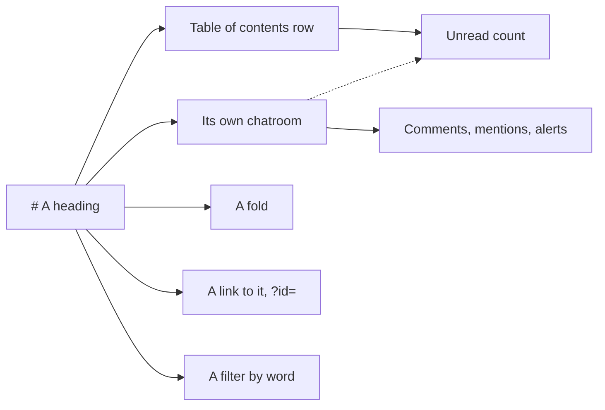
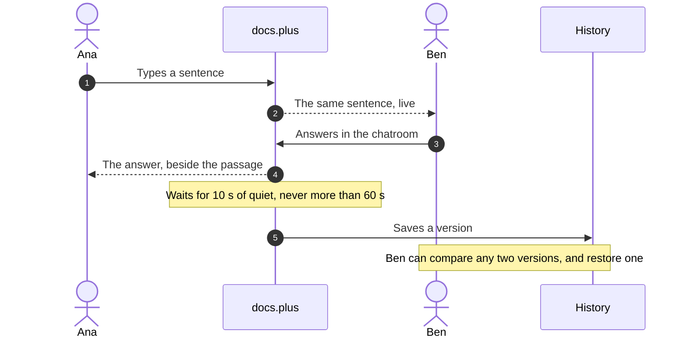
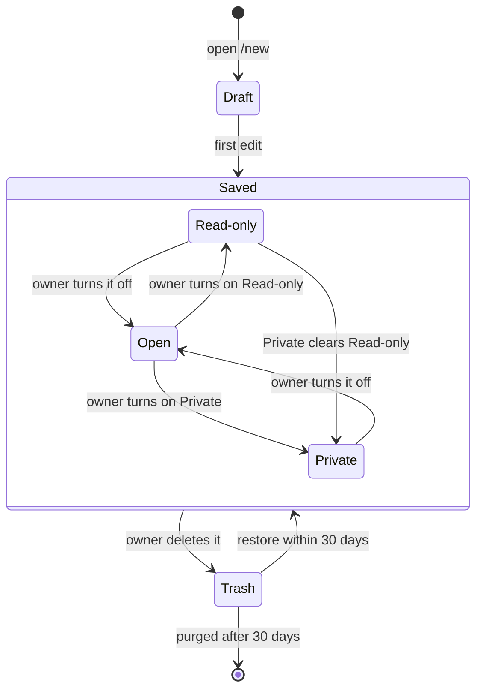
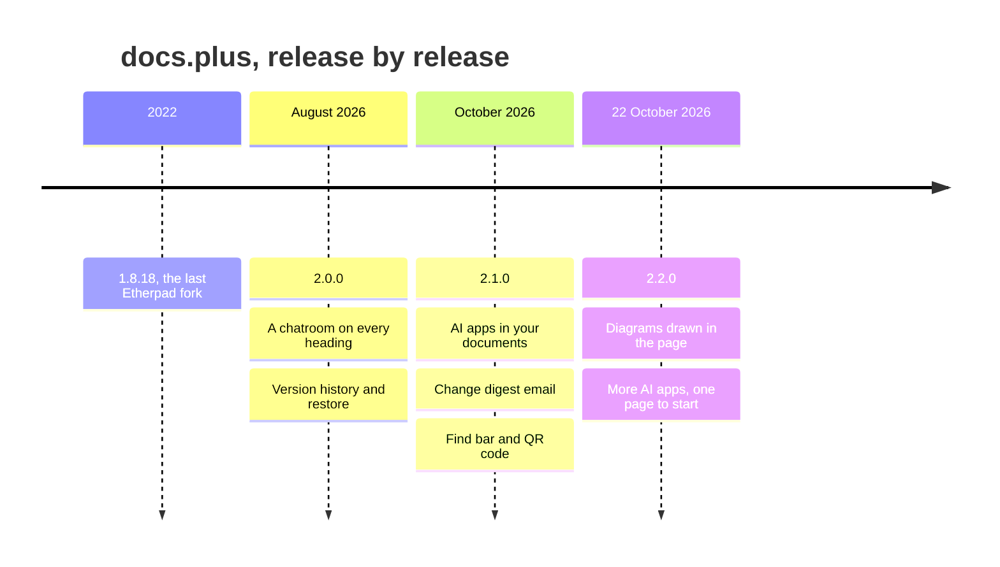
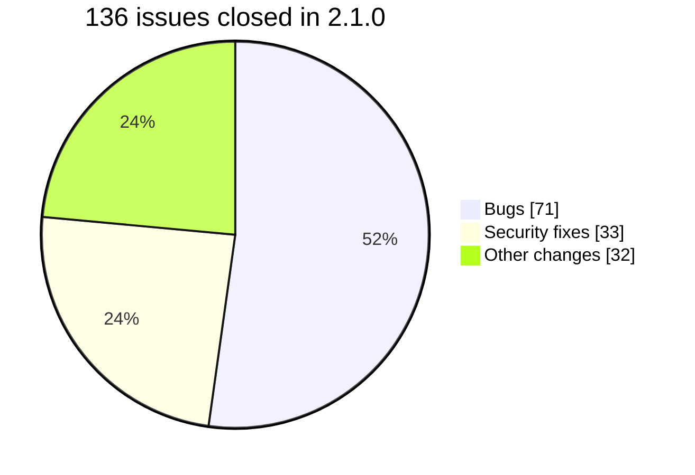
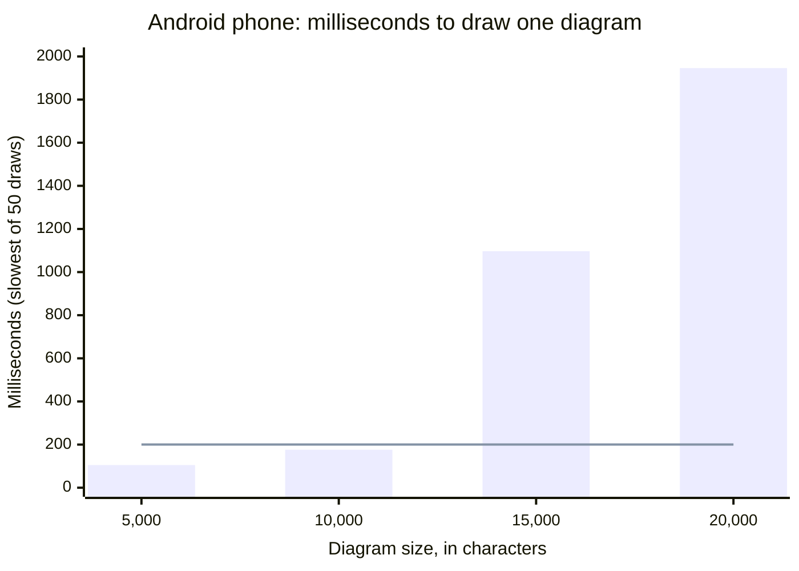
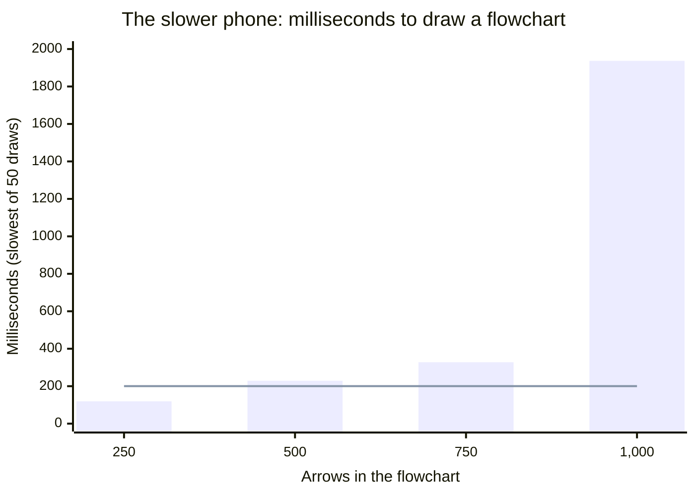

# ✨ docs.plus demo


Every line below is a filter, not an anchor. Click one and the page folds to that section alone.

- [👋 Start here](/demo/start%20here)
- [💬 A chatroom on every heading](/demo/notifications)
- [🗂️ The table of contents](/demo/invisible)
- [🔍 Filter by word](/demo/filter%20by%20word)
- [🧱 Why a section behaves this way](/demo/behaves)
- [🔗 Links](/demo/mailto)
- [🎬 Media](/demo/soundcloud)
- [✍️ Writing](/demo/writing)
- [📊 Diagrams](/demo/pele)
- [📜 What the history holds](/demo/versions)
- [📤 Import and export](/demo/import%20and%20export)
- [🔐 Who can open this document](/demo/owner-only)
- [🚀 Make your own](/demo/make%20your%20own)
- [🆕 What's new in docs.plus 2.1.0](/demo/release)

# 👋 Start here

docs.plus is a shared document where **every heading has its own chatroom**.

**This page is docs.plus running**, not a picture of it. Try the things it describes as you read them.

Open the chatroom on this heading from the chat button on its table of contents row — try it here.

This document is **read-only**. [/new](/new) opens a blank document you can write in.


_The chatroom for a passage sits beside the passage, not at the bottom of the page._

Filtered to this section? [Show the whole document](/demo).

# 💬 A chatroom on every heading

Every heading carries its own chatroom. The talk about a passage sits beside the passage, not at the bottom of the page and not in another app.

A reply under a heading needs no quoted context. The passage is directly above it.

## One chatroom per heading

Messages posted under a heading **belong to that heading**. They show up nowhere else in the document. There is no general channel they fall into.

Open the chatroom on this heading, read it, and scroll back through it — try it here.

On desktop, move the pointer anywhere over a section, and its heading's chat button shows beside the heading. Click it to open that chatroom — try it here.

On desktop, drag the top edge of the docked chatroom down to close it. Let go below 160px and it closes. Let go between 160px and 320px and it returns to 320px — try it here.

A dated line separates the days. New messages, edits and reactions **arrive without a reload**.

A reply carries the message it answers: the author, the time, and a short run of it. Click that quoted block and the chatroom opens the message it came from — try it here.

Signed out, the composer opens the sign-in dialog instead of sending — needs an account.


_A reply quotes the message, not the page. The page is already above it._

## Counts sit in the table of contents

In the table of contents, a heading with messages swaps the chat button's icon for a count.

Signed out, that number is **the chatroom's total message count**. It counts every message in the chatroom, not the ones that are new to you.

Signed in, the same badge becomes **your own unread count**. Scrolling through the chatroom clears it — needs an account.

## Comments point at a passage

A comment **carries the passage it is about**: an excerpt for text, a thumbnail for a picture or a video, framed in that media's colour.

Click the quoted block on a comment — try it here. The document scrolls to that exact run of text, not to the top of the section.

When the passage can no longer be found, the jump lands on the heading instead.

A comment starts in the document body. It posts into the chatroom of the heading that holds it — needs a document you can edit.

## Who is in the chatroom

On desktop, **a stack of faces sits on the table of contents row** of every heading whose chatroom someone has open. Hover a face for the name — try it here.

Signed in, a face also shows what that person is doing. A bouncing face means typing, a smile means choosing an emoji, and a mic means recording a voice note — needs an account.

A heading row shows up to four faces, then a count of the rest.

The stack **follows open chatrooms, not scroll position**. On a quiet document it stays empty.

Signed out, you see other people and they do not see you. Your own face joins a row once you sign in — needs an account.


_A count means messages. A face means someone has that chatroom open._

## 🔓 Read-only locks the text, not the chatroom

The lock **stops at the document body**. Every chat control on this page still works. The chat button on each table of contents row opens its chatroom. The composer sends once you are signed in, and the message arrives for anyone who has that chatroom open.

The text is fixed. The talk is not.

The table of contents is the exception. Its drag grip and its Delete section entry still respond on this page. Both write into the document — needs a document you can edit. The server refuses what they send, so **do not press them here**. Delete section asks you to confirm first, so press Cancel if you open it.

Open the chatroom on this heading and say what you would use a per-heading chatroom for — needs an account.

## What a chatroom takes once you sign in

**Everything under this heading** needs an account. This heading has sub-headings, so its table of contents row carries a chevron. Fold the section from that chevron to put it away — try it here.

### Reactions

Each emoji on a message is a _chip_, and reading a chip takes no account.

A chip carries a number only when more than one person used that emoji. A single reaction shows the emoji alone.

On desktop, the smiley in the hover menu opens the full picker. On mobile, a long press offers eleven one-tap emoji, and a `+` for the rest — needs an account.

A reaction chip **is not a toggle**. On desktop, clicking a chip you are part of takes your own reaction back off, and it never adds one — needs an account.


_One tap answers, and the chatroom stays short._

### Files and voice notes

A chatroom takes what the page takes: images, video, audio, PDF, text, CSV, Markdown, JSON, Word, Excel, PowerPoint and ZIP.

The caps are **10 MB per file, 10 files per message, and 3 uploads at a time**. A voice note runs to 5 minutes and draws 24 live bars from the microphone as it records — needs an account.

On a phone, hold the mic to record. Slide up to lock, slide left to cancel, and let go to send. A tap shows a hint and never sends — needs an account.

An audio clip in a chatroom plays with seek, at 1×, 1.5× or 2× speed. Starting one clip pauses the others. A voice note sent from 2.1.0 on shows a 40-bar waveform and its length before you press play. Post a voice note to hear one — needs an account.

Two to ten pictures in one message lay out as a single tiled block. Click a tile for the full-screen gallery, and download from there — try it here.

An image can be sent as a spoiler, blurred until the reader taps it. Video and audio cannot — needs an account.


_A chatroom takes what the page takes, inside a fixed set of caps._

### Keep a message for later

A bookmark saves a message to your own list, and a second tap takes it back off. The message keeps a Bookmarked tag in the chatroom — needs an account.

The list opens from the bookmark icon in the document toolbar, in three tabs: in progress, archive, and read. View on a row opens that heading's chatroom at the message — needs an account.


_The message keeps a tag. The list keeps the message._

### Mentions

Type `@`, then pick a name, to tell that person about the message. `@everyone` tells the whole chatroom — needs an account.

A name you pick from the list reaches that person, even after they rename. A name you only type **must match the whole username**. `@harvey` does not reach `harvey_marzban`, and `@everyone_team` does not fire `@everyone`.

A mention in a message is coloured and tappable. Tap it for that person's profile card — try it here. On your own empty card, Add bio and links opens Settings on Profile.


_A typed name matches in full, or sends no alert._

### Alerts, and how loud they are

A bell in the document header holds the list: mentions, replies, reactions, thread messages, channel events, direct messages, invitations and system alerts. The bell is hidden until you sign in.

View on a row opens that heading's chatroom at the message, and Mark all read clears the list — needs an account.


_Tap View. Land on the message._

Every heading has its own chatroom, so **every heading has its own level**. One bell in the chatroom header cycles All notifications, then Mentions only, then Muted. There is no menu — needs an account.


_Mute one section and keep the next one loud._

## Move a message into the page

Copy to doc **writes the message into the document**, under the heading that owns the chatroom. The line it leaves is dated and links back to the message. The message's files come with it — needs a document you can edit.

Reply in thread does the other half. It **turns a message into a new heading** in the document, then opens that heading's chatroom — needs a document you can edit.

Both controls stay visible on this page, and the server refuses both writes.

Copy link on a message works here. It puts a link to that message on your clipboard, and its icon turns into a check — try it here.


_Say it in the chatroom, keep it in the page._

Filtered to this section? [Show the whole document](/demo).

# 🗂️ The table of contents

Every heading in this document **gets a row in the table of contents**, at its own level, in document order. Scroll the page, and the row you are reading lights up. The table of contents scrolls itself, so that row stays in view. Click a row and the page scrolls to that heading — try it here.


_One row per heading. Fold from a row, and the page creases where the text went._

## What lands in a row

A row carries the level of the heading and the text you typed. A heading with no text **gets no row**. An empty heading stays invisible to the table of contents until you name it.

The table of contents has its own column. Drag the divider between that column and the page to resize it — try it here. The width runs from 240px to 46% of the column and page together. Your browser remembers a width above 240px. That gesture needs a mouse.

Drag the divider below 120px, and the column turns into the **tick rail**: a 32px strip with one tick per heading. The docked chatroom then spans the full width — try it here. Hover or focus a tick to preview its section, and click it to jump there. The button at the top of the rail, or a reload, brings the full table back.

## The row's menu

**Right-click a row for five entries** — try it here. Chat room opens the chatroom on that heading. Fold section folds it, and on a folded row it reads Unfold section. Focus section writes the heading text into the address as the only filter term. Copy link puts a link to that heading on your clipboard, and the copied link scrolls there on a cold page load.

On a focused row, `Shift+F10` or the Menu key opens the same menu — try it here.

Delete section removes the whole section, body text and media with it. It asks you to confirm first — needs a document you can edit.

The menu is desktop only. The document title row at the top has none.

## Folding

The chevron on a row folds its section — try it here. Body text, media and sub-headings hide, and **the page creases where they were**. The crease is sized by what it covers: two strips for a short section, up to four for a long one. Click a crease in the page to unfold it — try it here.

The chevron appears **only on a heading that has sub-headings**. A heading with body text alone folds from its right-click menu. `📜 What the history holds` is one of those — try it here.

A fold changes no text. It is **drawing, not editing**, which is why it works on this locked page. Your folds are kept per document, in your own browser. Reload, and the page comes back creased where you left it. Nobody else sees them.

A filter folds sections for you. It saves your own folds first, and puts them back when you clear the filter.

## Moving a section

Drag the grip on a row up or down to set the order — needs a document you can edit. Drag it sideways to set the depth. Each 24px step is one level, three steps at most, clamped between H1 and H6.


_Up or down sets the order. Sideways sets the depth. The whole section travels._

**The whole section travels**: the heading, its body text, its media, and every sub-heading under it. One undo step puts it back. The new level is written to the dragged heading alone, so sub-headings keep the levels they had.

The grip is desktop only.

Filtered to this section? [Show the whole document](/demo).

# 🔍 Filter by word

The path after the document name is the filter. Nothing else holds that state.

Open [/demo/spotify](/demo/spotify). The page folds down to the two sections that hold the word, and every hit is marked where it sits — try it here.


_The path after the document name is the filter. Every hit is marked where it sits._

A section stays open when the word appears in its own text: the heading, plus the body under it, down to the next heading. Its parents stay open with it, and so does everything nested beneath it.

The match is a plain run of letters, and it ignores case. So `fold` also finds `folding` and `unfold`.

Two things follow. A term that matches a heading always keeps that section, so every section name on this page works as a filter. And **the filter reads text, not subject matter**.

One of the two sections `spotify` keeps is `▶️ Embeds`. The other is this one, because the word sits here too.

**Every word in this document** is a filter term. Try [/demo/account](/demo/account) next. It keeps every claim that needs one, and this section again.

You do not have to use the links above. The **filter button in the toolbar** opens a search box that counts the matching sections as you type — try it here. Type any word on this page and watch the rest fold away. Whatever you type becomes the address, so you can hand that view to someone else.

## Either word, or both

[/demo/fold/drag](/demo/fold/drag) keeps a section that holds either word. `?mode=or` is the default, so naming it changes nothing.

[/demo/fold/drag?mode=and](/demo/fold/drag?mode=and) **demands both words in one section**. Its result is always a subset of the other, because an intersection cannot return more.

Two sections hold both words: this one, and `A section is a range`. Their parent headings stay open above them.

## The URL is the state

Active terms sit beside the title as chips. Each chip carries an × that drops that one term — try it here. Reset sits beside the chips, and clears every term and the mode with it. On desktop it fades in when you hover the row.

Copy what is in the address bar, and you have handed someone **the view itself, not a description of it**.

## Find, without folding

On desktop, press `⌘+F` or `Ctrl+F`. The **Find bar** opens at the top right of the page — try it here.

It counts the matches, such as 3 of 12. Previous, Next, `⌘+G`, `⇧+⌘+G` and `F3` step through them. `Escape` closes the bar.

The filter folds away what does not match. Find keeps the whole page and steps through it. A match inside a folded section opens that section, then folds it again when you move on.

On a phone, Find is a docked row, and the table of contents drawer offers it too.

Press `⌘+⇧+K` or `Ctrl+Shift+K` for the jump list — try it here. On this page it offers History, Filter, Find in document, New document and Demo. Type to narrow the list. Your Settings, alerts and documents join it once you sign in — needs an account.

Filtered to this section? [Show the whole document](/demo).

# 🧱 Why a section behaves this way

Every heading opens a section. Folding, the table of contents, the filter, and the chatroom on a heading **all key off that one fact**.

## A section is a range

A section is not a container you put text into. It is a _range_ the editor computes. It runs **from a heading to the next heading at the same level or above it**. When there is none, it runs to the end of the document.

Underneath, **the document stays flat**: one list of blocks, with nothing nested inside anything.


_A section is a span the editor computes over one flat list of blocks._

That range is the unit the rest of the product acts on. The table of contents row stands for it. A fold hides it. A filter keeps it or drops it. A drag carries it.

## 📐 Size comes from rank

Heading size is **computed, not chosen**. Nothing in the markup says 18pt.

1. Take the headings from one `#` to the next `#`. The document title takes no rank.
2. Collect the distinct levels among them, in order.
3. Give the first 24pt, the last 14pt, and space the rest evenly between.

| Distinct levels | Sizes, in points            | Step between ranks |
| --------------- | --------------------------- | ------------------ |
| 1               | 24                          | —                  |
| 2               | 24 · 14                     | 10                 |
| 3               | 24 · 19 · 14                | 5                  |
| 4               | 24 · 20.67 · 17.33 · 14     | 3.33               |
| 5               | 24 · 21.5 · 19 · 16.5 · 14  | 2.5                |
| 6               | 24 · 22 · 20 · 18 · 16 · 14 | 2                  |

The block that holds this heading is the proof. It starts at `🧱 Why a section behaves this way` and ends at the next `#`. That block uses two levels, so its sizes are 24pt and 14pt. This heading is a `##`, so it renders 14pt.

Now take the block that starts at `💬 A chatroom on every heading`. It uses three levels, so a `##` inside it renders 19pt. Same tag, different size, because **size answers how deep a heading sits inside its own block**.

Filtered to this section? [Show the whole document](/demo).

# 🔗 Links

Click a link on this page and a card opens under it, naming what sits on the other end — try it here. Going there takes a second click, on the card. You see where a link leads **before you commit to leaving**.

## Out to the web

[https://github.com/docs-plus/docs.plus](https://github.com/docs-plus/docs.plus) is an ordinary external link. Its card fills with **the page title and picture, held for 5 minutes**. Copy link sits on the card, and its icon turns into a check when the copy works — try it here. On desktop, Edit and Remove sit there too, but only on a document you can edit.

The card's title is itself a link, so one click on the title goes there — try it here. When the fetch fails, that title falls back to the raw address, and the link still works.

Middle-click a link to skip the card and open it in a new tab — try it here.

On mobile the card is a bottom sheet instead. Its four rows are Open link, Copy link, Edit link and Remove link. The first two work with no sign-in — try it here.

## Addresses that are not web pages

A `mailto:` or `tel:` link has no page to fetch. The address becomes the title, and the icon names the kind. The pad maps **40 schemes** this way: mail, phone, maps, video calls, and app links.

## Back into the document

A link into this document never touches the network. It resolves on the spot, and the card shows a destination chip. Five kinds exist: **This document**, a quoted heading, **Chat**, **Filtered view · N terms**, and **Version N**.

[/demo/crease](/demo/crease) is such a link. Its card carries a **Filtered view · 1 term** chip. Click the chip and the page folds in place — try it here. No reload, and no new tab.

Filtered to this section? [Show the whole document](/demo).

# 🎬 Media

**Nine kinds of media** sit in the body text: pictures, uploaded video, uploaded audio, and six embed providers.

## Images

A picture sits **in the run of the text**, not in a gallery beside it. While a remote picture loads, a grey shell holds its place.

Hover a picture and its toolbar appears — needs a document you can edit. The toolbar checks edit rights first, so this page shows the pictures and no toolbar.

Eight handles ring the picture with that toolbar up. The four side handles change one axis. The four corner handles change both and always keep the shape — needs a document you can edit. Nothing goes below 160px wide or 80px high.

## Video and audio

An uploaded file plays where it sits. Press play on the video and then on the audio below it — try it here.

Neither is built by pasting an address, the way the embeds are. Both arrive through the insert panel — needs a document you can edit. A file uploaded there can be up to 10,485,760 bytes, and the upload needs an account.

[/demo-assets/demo-video.mp4](/demo-assets/demo-video.mp4)

[/demo-assets/demo-audio.mp3](/demo-assets/demo-audio.mp3)

_Clip credits: the video is Big Buck Bunny, © Blender Foundation, CC BY 3.0. The audio is Example.ogg from Wikimedia Commons, CC BY-SA 3.0._

## ▶️ Embeds

Six providers **render in place rather than as links**: YouTube, Vimeo, Loom, SoundCloud, Spotify, and X. Paste a provider address into the body and the player is built on the spot — needs a document you can edit. No menu, and no dialog.

An X post has no drag grip. Its width comes from presets instead — needs a document you can edit.

A Spotify player will not go under its own height. A single track floors at 152px, and every other kind floors at 352px.

<https://www.youtube.com/watch?v=aqz-KE-bpKQ>

<https://vimeo.com/76979871>

<https://www.loom.com/share/e5b8c04bca094dd8a5507925ab887002>

<https://soundcloud.com/forss/flickermood>

<https://open.spotify.com/track/11dFghVXANMlKmJXsNCbNl>

<https://x.com/jack/status/20>

Filtered to this section? [Show the whole document](/demo).

# ✍️ Writing

Formatting shows a reader which decisions matter.

Type `/` on an empty line for a list of blocks to insert, from headings to pictures — needs a document you can edit. Try it in [/new](/new).

## Marks that mean something

Reach for a mark when it changes meaning, not when a sentence feels flat. **Bold names the one thing a skimming reader must not miss.** _Italic marks a term or a title._ ~~Strikethrough keeps the record when a decision moves.~~ ==Highlight is a note to self: a section still wearing one is still owed work.==


_Bold, italic, strikethrough, highlight: four marks, four jobs._

Each mark has a toolbar button and a key, from `⌘+B` for bold to `⌘+⇧+H` for highlight — needs a document you can edit. Highlight also survives Markdown, as `==text==`. Clear formatting, or `⌘+\`, takes the marks off and keeps headings and links — needs a document you can edit.

There is a fifth mark, underline, and it is the one to reach for least. On a page full of links, an underlined word claims to be one.

## Code stays code

Inline code sets **a flag, a path, or a value** apart from the prose: `--frozen-lockfile`, `mode=and`, `heading-scale.ts`. Type a backtick pair, or press `Mod-e` — needs a document you can edit.

For anything longer than a phrase, use a fenced block and name the language. The pad colours **exactly nine**: `html`, `css`, `js`, `ts`, `markdown`, `python`, `yaml`, `json`, and `bash`. Name a block `mermaid` and the pad draws it instead — see [📊 Diagrams](/demo/pele).

```bash
bun run --filter @docs.plus/webapp dev
```

Filtered to this section? [Show the whole document](/demo).

## Lists, quotes and rules

Three kinds of list, and the choice carries meaning. Pick the one that matches the thing.

A **bullet list** holds items with no order. Reordering it changes nothing.

- A heading opens a section
- A section is a range
- A range is what folds

A **numbered list** holds steps that run in order. Reordering it breaks the instructions.

1. Open a heading from its table of contents row
2. Read what is under it
3. Answer in the chatroom beside it

A **checkbox list** tracks work that is not finished. A tick is saved for everyone reading — needs a document you can edit.

- [ ] Seed the chatrooms with a real conversation
- [ ] Draw the version history picture
- [x] Put every illustration in the page

A **quote** sets words apart from your own.

> A section is not a container you put text into. It is a range the editor computes.

Type three dashes and the editor draws a rule across the page — needs a document you can edit.

---

A rule ends a passage. It carries no text, so a filter never keeps a section for it.

# 📊 Diagrams

Write a diagram as text, and docs.plus draws it under the text. **Every diagram below is drawn live in your browser**, not pasted as a picture.


_The text is the diagram. Change a word and the picture follows._

The text is Mermaid, the diagram language GitHub and Obsidian read. Pele draws it, the small Mermaid renderer by Steph Ango, CEO of Obsidian. Flowcharts, sequences, states, timelines, pie charts and more all work.

Type `/diagram` on an empty line, or pick Diagram from the Code menu, and you get a small example to change — needs a document you can edit. Try it in [/new](/new).

On this read-only page each diagram starts with its text folded away. Hover a diagram for three buttons: **Syntax** opens the Mermaid reference, **Copy** copies the text, and **Show source** opens it — try it here. Your choice is yours alone, and this browser remembers it.

Each diagram below sits under its own heading, so each one has its own chatroom — try it here.

## How a heading becomes a room



One heading gives you five things at once. The rest of this page shows each of them.

## Two people, one page



Edits reach everyone at once. History keeps a version after 10 seconds of quiet, and never waits more than 60.

## A document's life



Private and Read-only belong to the owner, and only one is on at a time. Trash keeps a document for 30 days.

## From Etherpad fork to diagrams



## 2.1.0 in one picture



## Measured on real phones

How big may a diagram be before it slows a phone down? We did not guess. We drew each size 50 times on a real Android phone and a real iPhone, and kept the slowest draw. Our budget is **200 ms**, the orange line. Every bar above it failed.



At 10,000 characters the phone stays under budget. At 15,000 it takes **1.1 seconds**, more than five times the budget. So a diagram stops at 10,000 characters.



Arrows cost more than text. Both phones went over budget at 500 arrows, so a diagram stops at 250.

| Size              | Mac   | iPhone     | Android      |
| ----------------- | ----- | ---------- | ------------ |
| 10,000 characters | 25 ms | 94 ms      | 176 ms       |
| 15,000 characters | 37 ms | 132 ms     | **1,097 ms** |
| 250 arrows        | 21 ms | 119 ms     | 119 ms       |
| 500 arrows        | 37 ms | **229 ms** | **202 ms**   |

A laptop would have said 20,000 characters is fine. The phone in your pocket is the real test. These two charts are drawn live by Pele too, from eight lines of text each.

## When a diagram goes wrong

A mistake shows one second after you stop typing, with the line it is on. The last good drawing stays on screen, faded, so the page never jumps — needs a document you can edit.

A diagram over **10,000 characters or 250 arrows** is not drawn, so a big one never freezes a phone. We measured that limit on a real iPhone and a real Android phone. The message names the limit it hit and the count, and asks you to split it.

A connected AI app can write diagrams too. docs.plus checks each one before the write, and refuses one that does not parse or is too large — needs an account.

History, print and dark mode all show the drawn diagram. Markdown export keeps the text as a `mermaid` block, so a diagram survives the trip out and back.

Filtered to this section? [Show the whole document](/demo).

# 📜 What the history holds

Every save is **a whole snapshot of the document**, with a rising version number. Typing is saved after 10 seconds of quiet, and forced after 60 seconds when you keep going.

Open the history from the clock button in the document header. A public document does not need an account to read it.

Versions arrive grouped into _sessions_, then into days titled Today, Yesterday, or a date. A session breaks after a gap of two minutes. A row carries the faces of the people in that version. It also carries a badge naming where the version came from: API, Checkpoint, Restored, Pre-restore, Migration, or Connected app. Connected app marks a version that an AI app wrote. An ordinary live save gets no badge.

The list shows the newest 50 versions. When a document has more, Show older versions loads the next 50.

Click a version and it renders in a read-only editor, so **reading an old draft changes nothing**. Heading chat is hidden while you read one. Inside the view you can compare two versions, copy a link to one, and print the one you are reading.

Compare marks what was added inline, and keeps what was removed as struck-through text. A change to formatting only, such as bold or a heading level, gets an edge on its block. The authors panel colours each block by whose text sits there now.

**Restore puts an old version back for everybody.** It is offered only to a signed-in writer, and only on a version that is not the latest. A visitor never sees the control. A restore writes a safety copy of the current text first, and that copy carries the Pre-restore badge.

After 30 days, old automatic saves are thinned to one per day. Each day's newest save survives. A version you named yourself is never thinned.

The history can name who wrote a run of text. It can **never name who deleted one**. A restore, an import, or an API write carries no author, so the badge names the operation instead.

A signed-in rename of the Pad title posts a notice in the document chat. History paints the latest of those notices above the editor. That notice is not a version. A signed-out rename posts nothing.

Signed in, you follow a document when you open it. Turn on email in Settings, and edits by other people arrive as a change digest email. It marks added and removed words under each changed heading — needs an account.

Turn Follow off in Document settings to stop that mail. In the alert list, View on a document change opens History with compare already open — needs an account.

Filtered to this section? [Show the whole document](/demo).


# 📤 Import and export

The gear button opens Document settings. Its Import & export section holds four export rows: Word `.docx`, Markdown `.md`, OpenDocument `.odt`, and Print / Save as PDF. **Print / Save as PDF works with no account** — try it here. Word, Markdown and OpenDocument ask you to sign in first — needs an account. Signed in, an export opens your browser's save picker where it has one, or the share sheet on iOS.

An export is built from the last saved version, so a very recent edit may be missing from it.

Import takes `.docx` and `.md` only, up to 10,485,760 bytes, and Markdown stops at 65,536 characters. It replaces the whole document — needs an account and a document you can edit. On this read-only page, Replace with a file says the document cannot be replaced — try it here. A Markdown replace keeps pictures at their natural size, and a lone video, audio, or embed URL becomes a player.

Filtered to this section? [Show the whole document](/demo).

# 🔐 Who can open this document

A document carries **two flags: Private and Read-only**. Private is owner-only. A signed-out visitor is asked to sign in, and any other signed-in person is refused. Read-only stops everyone but the owner from editing, and this page is read-only.

A document with no owner is open. Anyone may change its Pad title, signed in or not. A signed-in person who first clicks into, types in or opens chat in a new document becomes its owner. Typing in a document that already exists never makes you its owner. Private and Read-only do not turn on until the document has an owner. This page already has an owner, so only they can rename it.

The two flags are never on together. Turning Private on clears Read-only in the same request.

The header shows a chip for each flag. Open Document settings from the gear button to see the owner, and the two flags as badges — try it here. Only the owner sees them as switches.

Share sits in the header, signed in or not — try it here. The Share card shares **the whole document**, never the heading or filter you are on. To share a filtered view, copy the address bar.

The Share card also shows a QR code. Scan it with a phone to open this page, or click it for a full-screen Present view — try it here. A button next to Close switches Present to a dark background.

The access line here reads Anyone with the link can view. Only the owner sees Change beside it.

On desktop, the Document QR code button after Filter shows the code in a QR card at the top right. Drag the QR card's corner to size the code from 128px to 1024px — try it here. A reload hides the QR card.

A share link **carries no permission**. There is no token, no expiry, and no grant to one person. Who can open a document is decided by the two flags, and by who you are signed in as. On a private document the Share card hides the link and the QR code, and says to turn Private off in Settings.

Filtered to this section? [Show the whole document](/demo).

# 🚀 Make your own

[/new](/new) gives you a blank document with a random name, and you can write in it — try it here. **Nothing to install**, and no sign-up to start.

Everything above then runs the other way round. You can type, move a section, and insert media from its address. Uploading a file, replacing the whole document with a file, and posting in a chatroom ask you to sign in first — needs an account.

Signed in, you can connect an AI app, such as Claude or ChatGPT. A connected app can read this page and its chat. It edits only documents you own, so it cannot change this one — needs an account.

Your Documents list in Settings shows the documents you own and the ones you joined. Favorite a document you own to keep it at the top, and sort by Last opened — needs an account.

The code is open: [https://github.com/docs-plus/docs.plus](https://github.com/docs-plus/docs.plus).

Filtered to this section? [Show the whole document](/demo).

# 🆕 What's new in docs.plus 2.1.0


This is the 2.1.0 release, from 13 October 2026. Most parts end with a filter link to the place on this page that shows it.

## Your AI app can work in your documents

You can now connect Claude, ChatGPT or another AI app to docs.plus. It signs in as you, on a consent page — needs an account.

It reads the documents and chat you can open. It edits only documents you own, so it can read this page but never change it.

A version that an app wrote carries a Connected app badge in History. On this page: [/demo/connected app](/demo/connected%20app).

## An email when other people edit

You can now get a change digest email when other people edit a document you follow. It marks added and removed words under each changed heading — needs an account.

You follow a document when you open it while signed in. You get no mail for edits you saw live. On this page: [/demo/digest](/demo/digest).

## Find, jump and insert from the keyboard

On desktop, you can now press `⌘+F` or `Ctrl+F` for a Find bar that counts the matches — try it here.

You can now press `⌘+⇧+K` or `Ctrl+Shift+K` to jump to History, Filter, Find or a new document — try it here.

You can now type `/` on an empty line to insert a block — needs a document you can edit. Try it in [/new](/new).

On this page: [/demo/find bar](/demo/find%20bar).

## Share a document with a QR code

You can now share a document with a QR code. Open Share and scan the code, or click it for a full-screen Present view — try it here.

Present can switch to a dark background for a dark room. On desktop, the Document QR code button keeps the code in a QR card on the page — try it here.

The Share card now shares the whole document, never the heading or filter you are on. On this page: [/demo/qr code](/demo/qr%20code).

## Give the chatroom the full width

On desktop, you can now drag the divider below 120px, and the table of contents turns into a 32px tick rail. The docked chatroom then spans the full width — try it here.

On desktop, you can now drag the top edge of the docked chatroom down to close it — try it here.

On desktop, the heading chat button now shows while you hover anywhere in its section — try it here. On this page: [/demo/docked chatroom](/demo/docked%20chatroom).

## Voice notes you hold to record

You can now record a voice note on a phone by holding the mic. Slide up to lock, slide left to cancel, and let go to send — needs an account.

Chat audio now plays with seek, at 1×, 1.5× or 2× speed. A new voice note shows its waveform and length before you press play. Post one to hear it — needs an account.

On this page: [/demo/voice note](/demo/voice%20note).

## A calmer, clearer page

Cards, dialogs, menus and phone sheets now share one look. Every confirmation uses one dialog, with Cancel first.

Headings in a block now follow one size scale, from 24pt down to 14pt. Loading screens now match the page they turn into, so nothing jumps when content arrives.

On desktop, menus now open from the keyboard. On a focused table of contents row, `Shift+F10` or the Menu key opens its menu — try it here.

On this page: [/demo/rank](/demo/rank).

## Your documents on every device

You can now see the documents you own and the ones you joined in one list. Favorite the ones you own to keep them at the top, and sort by Last opened — needs an account.

A setting you save now shows in every open tab, and on every device where you are signed in — needs an account.

Home now has an Install app button. Share a Word or Markdown file into the installed app, and it becomes a new document you own — needs an account.

On this page: [/demo/documents list](/demo/documents%20list).

## Safer by default

A private document's chatroom now opens only for its owner. Files in Trash are no longer served, and server errors no longer show database text.

Chat messages and channels now accept changes only from the people allowed to make them. This release closes 33 security issues.

## In numbers

- 559 commits in 43 days
- 136 issues closed, with 71 bugs and 33 security fixes
- 1,216 tests pass
- 5 extensions at 2.1.0

Read every change in the [GitHub Release](https://github.com/docs-plus/docs.plus/releases/tag/v2.1.0) and the [CHANGELOG](https://github.com/docs-plus/docs.plus/blob/main/CHANGELOG.md).

Filtered to this section? [Show the whole document](/demo).

# 🆕 What's new in docs.plus 2.2.0


This is the 2.2.0 release, from 22 October 2026. Most parts end with a filter link to the place on this page that shows it.

## Draw a diagram with text

You can now write a `mermaid` code block, and docs.plus draws the diagram under it, in the pad and in History. Flowcharts, sequences, states, timelines, pie charts and 28 more types all work.

Hide source folds the text away, so readers see only the picture. This read-only page starts folded — try it here. Type `/diagram` on an empty line to insert one — needs a document you can edit.

On this page: [/demo/diagram](/demo/diagram).

## Limits measured on real phones

A diagram over 10,000 characters or 250 arrows is not drawn, so a big one never freezes a phone. We measured those limits on a real iPhone and a real Android phone, and the charts show why.

On this page: [/demo/phones](/demo/phones).

## More AI apps, one page to start

You can now start at [docs.plus/mcp](https://docs.plus/mcp), which gives the server URL and the steps for each AI app. Settings › Connected apps adds Claude Code, Codex, Copilot CLI and Cline, plus Add to LM Studio and Add to Replit — needs an account.

Your AI app can write diagrams too. docs.plus checks each one before the write, and tells the app why it refused one. On this page: [/demo/connected app](/demo/connected%20app).

## No more missed chat

Some people showed as Online for good, even months after they left. A plain chat message then sent them no bell, push or email. Now online means a recent heartbeat, and nobody is stuck.

A chat email is skipped when you already read the message in the chatroom. Someone who is typing now shows as present in the mention list too.

## Safer by default

A private document's images now load only for its owner. New database tables and functions start closed, and a guard checks the grants after each database update.

An AI app reads document titles inside a safe frame, so a title cannot pass itself off as an instruction. This release closes 20 security issues.

## In numbers

- 103 commits in 9 days
- 53 issues closed, with 12 bugs and 20 security fixes
- 1,401 tests pass
- 6 extensions at 2.2.0

Read every change in the [GitHub Release](https://github.com/docs-plus/docs.plus/releases/tag/v2.2.0) and the [CHANGELOG](https://github.com/docs-plus/docs.plus/blob/main/CHANGELOG.md).

Filtered to this section? [Show the whole document](/demo).
