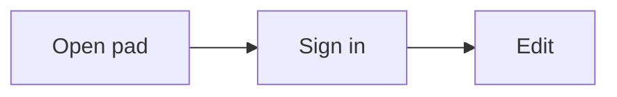

# Diagrams

How to insert, edit and read a Mermaid diagram in a docs.plus pad. It does not teach Mermaid syntax, and it does not cover the extension for developers. For that, see the [extension README](../extensions/extension-mermaid/README.md).

A diagram is a code block whose language is `mermaid`. You write the text. docs.plus draws the picture below it. The document stores only the text.

Diagrams are drawn by [Pele](https://pele.run), an open-source Mermaid renderer.

## Insert a diagram

Pick one of these.

- Type `/` on an empty line, then choose **Diagram**. You can also type `/mermaid` or `/flowchart`. You get a small starter flowchart.
- On a computer, open the **Code** menu in the toolbar and choose **Diagram**. It is the last item. You get the same starter flowchart.
- Type three backticks, the word `mermaid` and a space. You get an empty diagram block that shows the hint "Write a Mermaid diagram".

The starter flowchart comes only from the slash item and the **Code** menu. In each case the caret is in the text, so you can start editing at once.

## Edit a diagram

The text sits on top, and the diagram sits below it. There is no edit mode to switch on.

- The diagram redraws about a third of a second after you stop typing.
- A mistake in the text shows after about one second without typing. Until then, the last good diagram stays on screen.
- When there is a mistake, the last good diagram turns pale. A line below it names the line and column, and shows the message.
- Move the pointer over the frame to see **Syntax**, **Copy** and **Hide source**. Otherwise, only the word `mermaid` shows in the corner.
- **Syntax** opens the Mermaid syntax guide in a new tab. **Copy** puts the whole text on your clipboard.
- **Hide source** folds the text away, for you only. docs.plus remembers your choice in this browser. Nobody else sees it.
- The version history view starts with the text folded. A pad you cannot edit often starts folded too. There, choose **Show source** or the folded line to open it.
- While you edit, move the caret into a folded block and it opens again.
- docs.plus decides this when the diagram first appears. Turning on editing later does not unfold it. A phone opens a pad in read mode first, so diagrams there often start folded.
- On a phone, the buttons always show.

To turn a diagram back into plain code, open the **Code** menu and choose **Code block**.

Very large diagrams are not drawn. They show "This diagram is too large to draw." and name the limit they hit, for example "It has more than 500 arrows, and the limit is 500." Split them into smaller ones.

## Syntax

Diagrams use the Mermaid language. Read the [Mermaid syntax reference](https://mermaid.js.org/intro/syntax-reference.html) for the language and its rules.

Pele draws a subset of Mermaid. See [pele.run](https://pele.run) for the diagram types it draws. A type it does not know shows "This diagram type is not supported." The text stays in the document.

In a state diagram, write `state Check <<choice>>` before the first line that uses `Check`. The same holds for `<<fork>>` and `<<join>>`. Declared later, the state draws as a plain box. Mermaid itself works the same way.

## AI apps

An AI app connected through the [MCP connector](mcp/README.md) can write diagrams too. docs.plus checks each diagram before the write and refuses one that does not parse or is too large. The [MCP reference](mcp/reference.md#tools) lists each reason.

## Not supported

- **Chat.** A chat message shows a diagram as plain code.
- **The change digest email.** It carries no diagram.
- **Pictures in DOCX and ODT export.** The export carries the text as a code block, not the drawing.
- **Pictures in Markdown export.** The export keeps the `mermaid` fence. GitHub, GitLab and Obsidian draw it with mermaid.js, so the picture can differ from the pad.
- **Remote images and links inside a diagram.** They are off.

## Offline

Pele loads the first time a pad shows a diagram. If it cannot load, the diagram shows "Could not load the diagram renderer." and a **Try again** button.

Choose **Try again** when the connection is back. The diagram draws, and the page does not reload. A diagram that is already drawn stays on screen.

## Accessibility

Add a title and a description to each diagram, so a screen reader can read them. Write them as lines in the Mermaid text.

Do not use colour alone to carry meaning. Add a word or a different line style as well.
