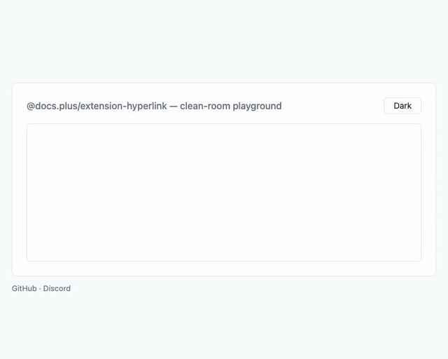
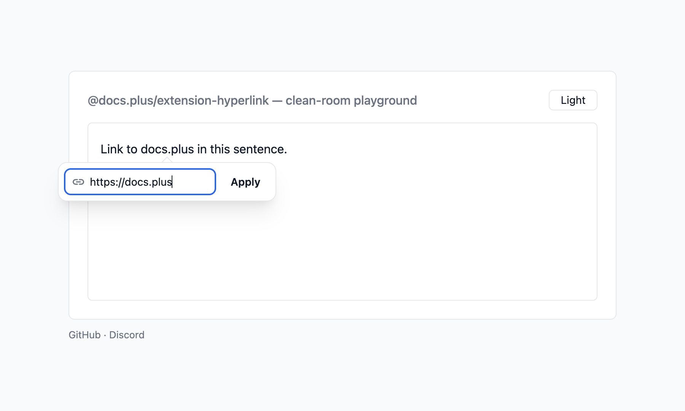
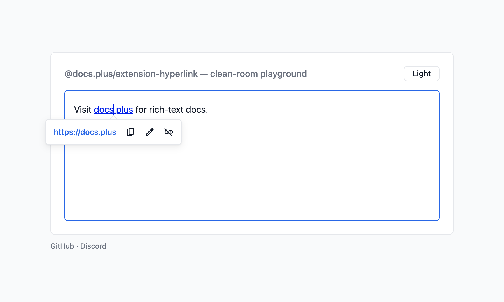
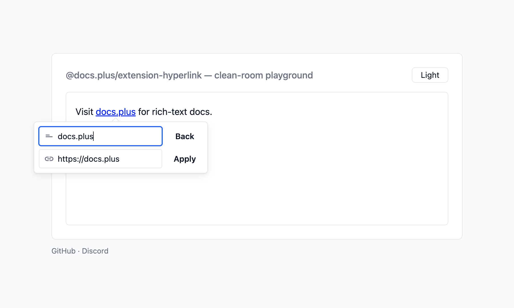
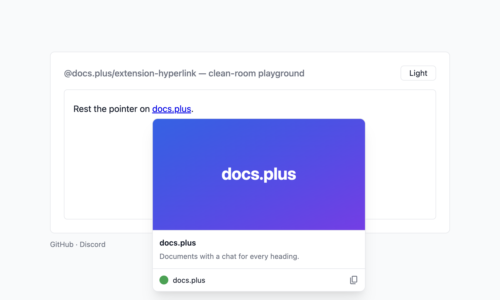

# @docs.plus/extension-hyperlink

[](https://github.com/docs-plus/docs.plus)
[](https://www.npmjs.com/package/@docs.plus/extension-hyperlink)
[](https://npmcharts.com/compare/@docs.plus/extension-hyperlink)
[](https://www.npmjs.com/package/@docs.plus/extension-hyperlink)
[](https://discord.gg/25JPG38J59)

<p align="center">
  <picture>
    <source media="(prefers-color-scheme: dark)" srcset="https://raw.githubusercontent.com/docs-plus/docs.plus/main/extensions/extension-hyperlink/assets/demo-dark.gif">
    
  </picture>
</p>

Tiptap hyperlink mark with optional prebuilt popovers for creating, previewing, and editing links.

It replaces the `@tiptap/extension-link` mark that StarterKit v3 bundles.

[](https://stackblitz.com/github/docs-plus/docs.plus/tree/main/extensions/extension-hyperlink/examples/vanilla?file=main.ts)

## Why use it

- **Autolink covers more than web URLs.** As you type, bare domains get `https://`, emails become `mailto:`, and E.164 phones become `tel:`. App schemes from a catalog of 47, such as `whatsapp://`, autolink too.
- **The link UI is included.** Prebuilt create, preview, and edit popovers ship with the package. With `Hyperlink`, `Mod-k` opens the create-link form with no configuration. Inside a link, `Mod-k` opens that link's preview when `popovers.previewHyperlink` is set, and `Alt-Enter` opens the link. Mod-click opens a link in a new tab. Every open uses a new tab until you set the `navigate` option. `@tiptap/extension-link` binds no keyboard shortcut.
- **Every boundary checks the scheme.** `isSafeHref` blocks `javascript:`, `data:`, `vbscript:`, `file:`, and `blob:` on parse, import, write, serialize, and navigation. An embedded tab or newline cannot hide a scheme from the gate.
- **Your `@tiptap/extension-link` configuration ports over.** `isAllowedUri` takes the same `(uri, ctx)` shape as `@tiptap/extension-link`, so an existing policy works unchanged. `setLink`, `unsetLink`, and `toggleLink` stay as aliases. `[label](url)` round-trips with `@tiptap/markdown`.

## Install

```sh
npm install @docs.plus/extension-hyperlink
```

Or use `pnpm add @docs.plus/extension-hyperlink`, `yarn add @docs.plus/extension-hyperlink`, or `bun add @docs.plus/extension-hyperlink`.

Requires **`@tiptap/core` ^3.32.2** and **`@tiptap/pm` ^3.32.2**. A Tiptap 3 release before 3.32.2 is not supported.

This package imports no React, Vue, or Next.js code. Use it from a plain page, Vite, React, Vue, Svelte, Next.js, Nuxt, or SvelteKit. Create the editor in the browser.

React Native has no DOM. Load the editor in a web view.

Installs two runtime dependencies, `@floating-ui/dom` and `linkifyjs`. The popover engine and the tooltip ship inside `dist`, so they add no third package.

Upgrading from `2.2`? No export or option was removed, and stored JSON and Yjs documents load as before. Some behaviour changed, such as Mod-click, `Mod-k` inside a link and two HTML parse rules. See [Migrating from 2.2 to 2.3](https://github.com/docs-plus/docs.plus/blob/main/extensions/extension-hyperlink/docs/migration.md#migrating-from-22-to-23).

Upgrading from `1.x`? Option names, command names, and CSS class names all changed — see [Migrating from 1.x](https://github.com/docs-plus/docs.plus/blob/main/extensions/extension-hyperlink/docs/migration.md#migrating-from-1x).

## Quickstart

[](https://stackblitz.com/github/docs-plus/docs.plus/tree/main/extensions/extension-hyperlink/examples/vanilla?file=main.ts)

Run this Quickstart in your browser first, with nothing to install. The app lives in [`examples/vanilla`](https://github.com/docs-plus/docs.plus/tree/main/extensions/extension-hyperlink/examples/vanilla).

The host page needs one mount point: `<div id="editor"></div>`. The snippet also imports `@tiptap/starter-kit`. Add it with `npm install @tiptap/starter-kit` when your app has none yet.

```ts
import { Editor } from '@tiptap/core'
import StarterKit from '@tiptap/starter-kit'
import {
  Hyperlink,
  createHyperlinkPopover,
  editHyperlinkPopover,
  previewHyperlinkPopover
} from '@docs.plus/extension-hyperlink'
import '@docs.plus/extension-hyperlink/styles.css'

const editor = new Editor({
  element: document.querySelector('#editor'),
  content: '<p>Try <a href="https://example.com">this link</a>.</p>',
  extensions: [
    // Disable StarterKit's bundled link mark — see Caveats.
    StarterKit.configure({ link: false }),
    Hyperlink.configure({
      popovers: {
        previewHyperlink: previewHyperlinkPopover,
        editHyperlink: editHyperlinkPopover,
        createHyperlink: createHyperlinkPopover
      }
    })
  ]
})
```

The `styles.css` import is optional. Without it, the prebuilt popovers render unstyled, and every popover shows with no fade, the hovercard included. The snippet also styles no document link — see [Popovers](https://github.com/docs-plus/docs.plus/blob/main/extensions/extension-hyperlink/docs/popovers.md) and [Style document links](#style-document-links).

You should see a paragraph with one link. Click the link to open the preview popover, with copy, edit, and remove actions. Type `example.org` and a space, and the text becomes a link. Select a word and press `Mod-k` (Cmd on macOS, Ctrl elsewhere) to open the create-link form.

To show a card when the pointer rests on a link, add the `hovercard` option. See [Show a card on hover](#show-a-card-on-hover).

## Caveats

- **`StarterKit.configure({ link: false })` is required, not stylistic.** StarterKit v3 bundles `@tiptap/extension-link` by default. The two marks collide on the `setLink` / `unsetLink` / `toggleLink` command names. Your `extensions` array order then decides which mark each command writes, with no warning. If you keep Link only to load stored `link` marks, parsed and pasted HTML still gives `hyperlink`. This package's `a[href]` rule runs at priority 51, above Link's default 50.
- **A click on a link, and `Mod-k` inside a link, need `popovers.previewHyperlink`.** With `Hyperlink`, the three openers, `openPreviewHyperlink`, `openEditHyperlink` and `openCreateHyperlink`, fall back to the prebuilt factory when a slot is `null`. `HyperlinkBase` has no fallback, so an empty slot opens nothing. The click handler and `Mod-k` inside a link do not fall back, with either mark. Leave `previewHyperlink` at `null`, and a click on a link opens no popover. `Mod-k` inside a link then does nothing, and it never opens the create form there.
- **`linkOnPaste: false` does not stop every paste from linking.** The linkify paste rule stays registered, so a pasted bare URL still becomes a link. To stop that path too, set `shouldAutoLink: () => false`, which every autolink path consults.
- **`HTMLAttributes.target` reaches the DOM.** `HTMLAttributes: { target: '_blank' }` does emit `<a target="_blank">`. A browser-driven `target="_blank"` navigation skips the click gate. Leave `target` at `null` and let the click handler open the link.
- **Markdown keeps only the link `href`.** Export writes `[text](href)`, and import reads the href alone, so a link `title` is lost both ways. A custom `rel` is lost too, and import sets the default `rel`. `target`, `class` and `image` never reach Markdown, by design.
- **A link icon needs CSS for `.hyperlink-icon`.** Without `styles.css` or your own rule, the icon shows at its natural size. `styles.css` sizes it only inside `.ProseMirror`, so an icon from `linkIconFor` outside an editor needs your own rule. Without such a rule, a Tailwind host also breaks the line, because preflight sets `img` and `svg` to `display: block`. The `styles.css` rule wins over preflight inside `.ProseMirror`.
- **`linkIcon` must return a fresh element with no text.** `null` gives a plain link with no error. Any other result, or a throw, gives a plain link and one console error for that `linkIcon` function.
- **A host mark above `priority: 1000` splits one link into two icons.** That mark renders outside the link. When it covers part of a link, the `<a>` splits in two, and each part gets an icon.
- **`Hyperlink.extend({ addMarkView })` replaces the icon mark view.** To keep the icon, call `this.parent?.()` and wrap its result.
- **Legacy `link` marks get no icon.** Only the `hyperlink` mark renders through the icon mark view.
- **Parsed HTML drops every `.hyperlink-icon` element.** The rule runs even with `linkIcon` unset, so content inside an element with that class is lost on load and paste.
- **A `{ light, dark }` pair has limits.** It needs `styles.css` or your own `.hyperlink-icon` size, or the span has zero width. A bad URL shows a blank 1em box. Browsers before Chrome 150, Firefox 150 and Safari 27 show the light image.
- **A transient image failure hides that icon until reload.** This holds for an `` icon from `linkIconFetcher` or from an image URL entry in `linkIconMap`. Each helper never requests a failed URL again, until the page reloads or you build a new helper. A `{ light, dark }` pair keeps no such list.
- **A pointer already resting on a link gets no hovercard.** The card starts only on `pointerover`. When a link renders under a still pointer, no card shows until the pointer leaves the link and comes back.
- **The hovercard sees only this bundle's popovers.** It opens no card while a preview, create or edit popover of this package is mounted. A popover from another bundle, such as `@docs.plus/extension-hypermultimedia`, does not stop it.

The full list, with the reason for each, is in [Caveats](https://github.com/docs-plus/docs.plus/blob/main/extensions/extension-hyperlink/docs/api.md#caveats).

## Common tasks

### Set a link from your own button

Every command lands on `editor.commands` and on `editor.chain()`. On `editor.commands`, each returns `boolean`, and `false` marks a no-op.

```ts
editor.chain().focus().setHyperlink({ href: 'https://example.com' }).run()
editor.getAttributes('hyperlink').href // read the current href
```

`setHyperlink` returns `false` when `href` is empty, when the [composed gate](https://github.com/docs-plus/docs.plus/blob/main/extensions/extension-hyperlink/docs/api.md#validate-vs-isalloweduri) rejects it, or when the schema cannot apply the mark there. See [Commands](https://github.com/docs-plus/docs.plus/blob/main/extensions/extension-hyperlink/docs/api.md#commands) for the full list.

### Open the create-link form

Outside a link, `Mod-k` calls this command. Call it from your own toolbar button too:

```ts
editor.commands.openCreateHyperlinkPopover()
```

`openCreateHyperlinkPopover` opens UI, so `editor.can().openCreateHyperlinkPopover()` reports availability without mounting anything. With nothing selected, the prebuilt form inserts the typed URL as its own link text.

### Leave out the prebuilt popovers

Pass all three popover slots? Then use `HyperlinkBase` in place of `Hyperlink`. It is the same mark without the prebuilt preview, edit and create forms, so a StarterKit app ships about 2 kB gzip less. With `HyperlinkBase`, an empty slot opens nothing, and `openPreviewHyperlink` and `openCreateHyperlink` return `false`. With no create slot, `editor.can().openCreateHyperlinkPopover()` returns `false`, and the mark leaves `Mod-k` outside a link to the browser. Keep `Hyperlink` when you use any prebuilt form, or when you are unsure.

```ts
import { HyperlinkBase } from '@docs.plus/extension-hyperlink'

// Each slot is your own factory: (options) => HTMLElement | null.
HyperlinkBase.configure({ popovers: { previewHyperlink, editHyperlink, createHyperlink } })
```

### Style document links

The `styles.css` stylesheet skins the popovers and the hovercard's tooltips. The mark renders a plain `<a>` with no class, so style your document links yourself:

```ts
Hyperlink.configure({ HTMLAttributes: { class: 'my-link' } })
```

```css
a.my-link {
  color: #2563eb;
  text-decoration: underline;
}
```

For theme tokens, dark mode, and class names, see [Styling](https://github.com/docs-plus/docs.plus/blob/main/extensions/extension-hyperlink/docs/styling.md).

### Show an icon before each link

`linkIcon` takes a sync function. It receives `{ href }` and returns a fresh element, or `null` for a plain link:

```ts
Hyperlink.configure({
  linkIcon: ({ href }) => {
    const icon = document.createElement('span')
    icon.style.background = href.startsWith('https:') ? '#16a34a' : '#9ca3af'
    return icon
  }
})
```

The icon goes first inside each `<a>`, and the link text sits in a `<span>` after it. Only an href that passes `isSafeHref` reaches the function. `validate` and `isAllowedUri` do not run for icons. `styles.css` sizes the icon to `1em`. See [Options](https://github.com/docs-plus/docs.plus/blob/main/extensions/extension-hyperlink/docs/api.md#options).

Two helpers build that function for you. `linkIconMap` is an offline table from domain to icon. `linkIconFetcher` builds one `` per link from the link's origin, for example through your own favicon route. Chain them with `??`, so a map hit wins and the fetcher helper never runs for it:

```ts
import { Hyperlink, linkIconFetcher, linkIconMap } from '@docs.plus/extension-hyperlink'

const icons = linkIconMap({ 'example.com': '/icons/example.svg' })
const favicons = linkIconFetcher({
  src: (origin) => `/favicon?origin=${encodeURIComponent(origin)}`
})
Hyperlink.configure({ linkIcon: (ctx) => icons(ctx) ?? favicons(ctx) })
```

`linkIconFetcher` takes two options: `src` and `tile`. `src` gets the link's origin, such as `https://example.com` or `https://example.com:8080`, with no path and no trailing slash. It must return an image URL string. Your route may answer with any image the browser can draw. If `src` throws, the link stays plain, and the package logs one console error. Links that share an icon URL share one request. Each `` has `alt=""`, a 16 × 16 fallback size and `referrerPolicy="no-referrer"`. It stays hidden until it loads, so a failed load shows no icon. To skip a link, wrap the fetcher in your own function that returns `null`. `tile: true` paints a light square behind each icon on a dark `color-scheme`. On a light scheme the tile is clear. `linkIconMap` keys are bare hostnames: `www.` is ignored, a subdomain matches its parent key, and the href port does not count. Both helpers cover `http:` and `https:` links only. A `mailto:`, `tel:` or app link has no web origin, so each helper returns `null` for it. When every function in the `??` chain returns `null`, the link stays plain. To give those links an icon, chain your own function that reads `href`.

The `favicons` function above also works as the hovercard's `siteIcon`. A map entry may also be a `{ light, dark }` pair of image URLs, or a function that returns an element. See [Link icons](https://github.com/docs-plus/docs.plus/blob/main/extensions/extension-hyperlink/docs/api.md#link-icons).

### Show a card on hover

The `hovercard` option shows a card when a mouse pointer rests on a link. Your `fetchMetadata` returns the title, description and picture, and the package makes no request of its own:

```ts
import { Hyperlink } from '@docs.plus/extension-hyperlink'
import '@docs.plus/extension-hyperlink/hovercard.css'
import '@docs.plus/extension-hyperlink/styles.css' // the card's tooltips

Hyperlink.configure({
  hovercard: {
    fetchMetadata: async ({ href }) => {
      const res = await fetch(`/metadata?url=${encodeURIComponent(href)}`)
      if (!res.ok) return null
      const page = await res.json()
      // Map your server's fields to HovercardData. `image` is `{ url }`, not a string.
      return {
        title: page.title,
        description: page.description,
        image: page.image ? { url: page.image } : undefined
      }
    }
  }
})
```

The built-in card shows the picture, the title, the description and a link line with Copy link. On an editable link whose text is its own URL, the line also shows Use page title. To draw your own card, add `render`. See [Hovercard](https://github.com/docs-plus/docs.plus/blob/main/extensions/extension-hyperlink/docs/hovercard.md) for the data contract, `render`, the timing and the keys.

### Name pasted links after their page

The `pasteTitle` option swaps a pasted bare URL for the page title. The link appears at once with the URL, and your `fetchTitle` returns the title:

```ts
import { Hyperlink } from '@docs.plus/extension-hyperlink'

Hyperlink.configure({
  pasteTitle: {
    fetchTitle: async ({ href, signal }) => {
      const res = await fetch(`/metadata?url=${encodeURIComponent(href)}`, { signal })
      if (!res.ok) return null
      const data = await res.json()
      return typeof data.title === 'string' ? data.title : null
    }
  }
})
```

The swap is its own undo step, so one `Mod-z` restores the URL. `Mod-Shift-v` pastes the raw URL, and `shouldFetch` can follow a user setting. With no answer in 4 s, the URL stays. See [Paste title](https://github.com/docs-plus/docs.plus/blob/main/extensions/extension-hyperlink/docs/paste-title.md) for the rules, the title cleaning and a safe backend.

## Gallery

Prebuilt create, preview, and edit popovers (`styles.css` + `popovers` config), and the built-in hovercard (`hovercard.css` + `hovercard` option). Each screenshot has a light and a dark version, and follows your system preference.

<details>
<summary><strong>Create</strong> — Mod+K</summary>

<p align="center">
  <picture>
    <source media="(prefers-color-scheme: dark)" srcset="https://raw.githubusercontent.com/docs-plus/docs.plus/main/extensions/extension-hyperlink/assets/create-dark.png">
    
  </picture>
</p>

</details>

<details>
<summary><strong>Preview</strong> — click a link</summary>

<p align="center">
  <picture>
    <source media="(prefers-color-scheme: dark)" srcset="https://raw.githubusercontent.com/docs-plus/docs.plus/main/extensions/extension-hyperlink/assets/preview-dark.png">
    
  </picture>
</p>

</details>

<details>
<summary><strong>Edit</strong> — preview → Edit</summary>

<p align="center">
  <picture>
    <source media="(prefers-color-scheme: dark)" srcset="https://raw.githubusercontent.com/docs-plus/docs.plus/main/extensions/extension-hyperlink/assets/edit-dark.png">
    
  </picture>
</p>

</details>

<details>
<summary><strong>Hovercard</strong> — rest the pointer on a link</summary>

<p align="center">
  <picture>
    <source media="(prefers-color-scheme: dark)" srcset="https://raw.githubusercontent.com/docs-plus/docs.plus/main/extensions/extension-hyperlink/assets/hovercard-dark.png">
    
  </picture>
</p>

</details>

## Documentation

| Guide                                                                                                                | What it covers                                                                                                          |
| -------------------------------------------------------------------------------------------------------------------- | ----------------------------------------------------------------------------------------------------------------------- |
| [API reference](https://github.com/docs-plus/docs.plus/blob/main/extensions/extension-hyperlink/docs/api.md)         | Options, commands, keyboard shortcuts, the full caveats list, server bundles, and TypeScript exports                    |
| [Popovers](https://github.com/docs-plus/docs.plus/blob/main/extensions/extension-hyperlink/docs/popovers.md)         | The three popover slots, factory option shapes, openers, and custom popovers                                            |
| [Hovercard](https://github.com/docs-plus/docs.plus/blob/main/extensions/extension-hyperlink/docs/hovercard.md)       | The link card on hover: the built-in card, the data contract, custom `render`, timing, and keys                         |
| [Paste title](https://github.com/docs-plus/docs.plus/blob/main/extensions/extension-hyperlink/docs/paste-title.md)   | A pasted URL named after its page: when it runs, the resolver contract, undo and a safe backend                         |
| [Styling](https://github.com/docs-plus/docs.plus/blob/main/extensions/extension-hyperlink/docs/styling.md)           | The stylesheet, `--hl-*` theme tokens, dark mode, and class names                                                       |
| [URL handling](https://github.com/docs-plus/docs.plus/blob/main/extensions/extension-hyperlink/docs/url-handling.md) | Href normalization, scheme classification, and Markdown round-trip                                                      |
| [Security](https://github.com/docs-plus/docs.plus/blob/main/extensions/extension-hyperlink/docs/security.md)         | The dangerous-scheme gate at each boundary, and the exported safety helpers                                             |
| [Advanced](https://github.com/docs-plus/docs.plus/blob/main/extensions/extension-hyperlink/docs/advanced.md)         | The floating-popover primitive, the UI controller, and the tooltip primitive                                            |
| [Migration](https://github.com/docs-plus/docs.plus/blob/main/extensions/extension-hyperlink/docs/migration.md)       | What to check from 2.2 to 2.3, and the renamed options, commands, CSS classes, and popover APIs from 1.x                |
| [Changelog](https://github.com/docs-plus/docs.plus/blob/main/extensions/extension-hyperlink/CHANGELOG.md)            | Every release and its breaking changes                                                                                  |
| [For AI coding agents](https://cdn.jsdelivr.net/npm/@docs.plus/extension-hyperlink/README.md)                        | This README as plain Markdown for your agent. The docs are also on [Context7](https://context7.com/docs-plus/docs.plus) |

## Part of docs.plus

This extension is built for and maintained by [docs.plus](https://docs.plus). docs.plus is a free, real-time collaboration tool that lets communities organize knowledge hierarchically, with a chat thread on every heading. docs.plus runs these packages from source in production, so every release is exercised there before it reaches npm.

- Website: [docs.plus](https://docs.plus)
- Project README: [docs-plus/docs.plus](https://github.com/docs-plus/docs.plus#readme)
- Sibling extensions and recommended pairings: [extensions/README.md](https://github.com/docs-plus/docs.plus/blob/main/extensions/README.md)

## Contributing

Bug reports and PRs welcome. Setup, test commands, and the playground harness live in [CONTRIBUTING.md](https://github.com/docs-plus/docs.plus/blob/main/extensions/extension-hyperlink/CONTRIBUTING.md).

## License

MIT — see [LICENSE](https://github.com/docs-plus/docs.plus/blob/main/LICENSE).
