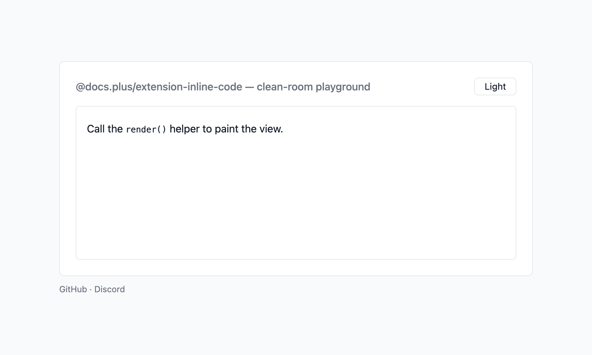

# @docs.plus/extension-inline-code

[](https://github.com/docs-plus/docs.plus)
[](https://www.npmjs.com/package/@docs.plus/extension-inline-code)
[](https://npmcharts.com/compare/@docs.plus/extension-inline-code)
[](https://www.npmjs.com/package/@docs.plus/extension-inline-code)
[](https://discord.gg/25JPG38J59)

<p align="center">
  <picture>
    <source media="(prefers-color-scheme: dark)" srcset="https://raw.githubusercontent.com/docs-plus/docs.plus/main/extensions/extension-inline-code/assets/preview-dark.png">
    
  </picture>
</p>

Tiptap mark for inline code (`` `code` ``).

It takes the place of `@tiptap/extension-code` and StarterKit's `code` mark, with the same `<code>` tag and the same `Mod-e` key. `Mod` is Cmd on macOS and Ctrl elsewhere. The names differ: the mark is `inlineCode`, and the commands are `setInlineCode()`, `toggleInlineCode()` and `unsetInlineCode()`.

[](https://stackblitz.com/github/docs-plus/docs.plus/tree/main/extensions/extension-inline-code/examples/vanilla?file=main.ts)

## Why use it

- **No stray space when you leave a code span.** `@tiptap/extension-code` inserts a space when `ArrowRight` exits a code span. This mark never inserts a character. At the end of the document, `ArrowRight` makes the next character plain. In an earlier paragraph, press `Mod-e` instead — see [Caveats](#caveats).
- **The character before the opening backtick stays plain.** Typing `` x`x` `` marks the content alone. The `@tiptap/extension-code` rule captures that character in its match, so it can delete it or mark it. Safari before 16.4 is the exception — see [Install](#install).
- **No code span across a hard break or a mention.** The typing rule declines a match that spans a hard break, a mention, or any other inline node that is not text. A mention is an inline `@name` node, such as the one `@tiptap/extension-mention` adds. `@tiptap/extension-code` has no such check, so its rule converts the match.
- **Code spans keep their backticks in Markdown.** The mark handles Markdown code spans (the `codespan` token). So a code span survives export and import once your app loads `@tiptap/markdown`. A mark without Markdown hooks exports the text with no backticks. A span that holds a backtick is the exception — see [Caveats](#caveats).

## Install

```sh
npm install @docs.plus/extension-inline-code
```

Or use `pnpm add @docs.plus/extension-inline-code`, `yarn add @docs.plus/extension-inline-code`, or `bun add @docs.plus/extension-inline-code`.

Requires **`@tiptap/core` ^3.32.2** and **`@tiptap/pm` ^3.32.2** (Tiptap 3.x). They are peer dependencies. If your app does not have them yet, run `npm install @tiptap/core@^3.32.2 @tiptap/pm@^3.32.2`. Keep every `@tiptap/*` package in your app on the same version.

This package imports no React, Vue, or Next.js code. Use it from a plain page, Vite, React, Vue, Svelte, Next.js, Nuxt, or SvelteKit. Create the editor in the browser.

React Native has no DOM. Load the editor in a web view.

Installs with no runtime dependencies.

Safari before 16.4 has no RegExp lookbehind. The package still loads there. Both the typing rule and the paste rule fall back to the `@tiptap/extension-code` pattern. So a non-space character before the opening backtick is removed. Typing `` x`y` `` deletes the `x`, and pasting `` x`y` `` drops it too. Safari 16.4 and later keep that character plain. Nothing else changes there: `Mod-e`, the commands, `ArrowRight` and Markdown work the same. On iOS before 16.4, this applies to every browser, because every iOS browser uses the Safari engine. iOS 16.4 ships Safari 16.4.

Upgrading from `2.2.0` to `2.3.0`? No behavior changed. 2.3.0 adds no exports and changes no types. The Tiptap peer floor rose from `^3.31.3` to `^3.32.2`, to match the rest of the docs.plus extension family. 2.2.0 also runs on Tiptap 3.32.2. So first move `@tiptap/core`, `@tiptap/pm` and your other `@tiptap/*` packages to `^3.32.2`. Those include `@tiptap/starter-kit` and `@tiptap/markdown` if you use them. Then update this package. In the other order, your package manager can report a peer dependency conflict. For an older `2.x`, read each entry in the [Changelog](https://github.com/docs-plus/docs.plus/blob/main/extensions/extension-inline-code/CHANGELOG.md).

Upgrading from `@tiptap/extension-code`? See [Migrating from `@tiptap/extension-code`](https://github.com/docs-plus/docs.plus/blob/main/extensions/extension-inline-code/docs/migration.md).

## Quickstart

[](https://stackblitz.com/github/docs-plus/docs.plus/tree/main/extensions/extension-inline-code/examples/vanilla?file=main.ts)

Run this Quickstart in your browser first, with nothing to install. The app lives in [`examples/vanilla`](https://github.com/docs-plus/docs.plus/tree/main/extensions/extension-inline-code/examples/vanilla).

The host page needs one mount point: `<div id="editor"></div>`. The snippet also imports `@tiptap/starter-kit`. Add it with `npm install @tiptap/starter-kit@^3.32.2` when your app has none yet.

```ts
import { Editor } from '@tiptap/core'
import StarterKit from '@tiptap/starter-kit'
import { InlineCode } from '@docs.plus/extension-inline-code'

const editor = new Editor({
  extensions: [
    // StarterKit's `code` mark claims the same `<code>` tag and the same
    // `Mod-e` key. Turn it off, or the document carries two code marks.
    StarterKit.configure({ code: false }),
    InlineCode
  ]
})
```

Not using StarterKit? Add `InlineCode` to your own extensions list. There is no `code` mark to turn off.

The snippet passes no `element`, so attach the editor to the mount point with `editor.mount()`, a Tiptap 3 method. Then load a sample line. In plain JavaScript, drop the TypeScript `!`:

```ts
editor.mount(document.querySelector('#editor')!)
editor.commands.setContent('<p>Call <code>render()</code> first.</p>')
```

The package ships no CSS. Browsers show `<code>` in a monospace font, and nothing more. Add this rule to give the span a background. `light-dark()` follows your page's `color-scheme`. Set `color-scheme: light dark` on `:root`, or the light values always apply. Browsers without `light-dark()`, such as Safari before 17.5, use the first `background` and `color` lines. That keeps dark text on a light background, in dark mode too. [Styling](https://github.com/docs-plus/docs.plus/blob/main/extensions/extension-inline-code/docs/guide.md#styling) has more rules.

```css
.ProseMirror :not(pre) > code {
  background: #f3f4f6;
  background: light-dark(#f3f4f6, #374151);
  color: #111827;
  color: light-dark(#111827, #f9fafb);
  border-radius: 4px;
  padding: 0.15em 0.3em;
  font-size: 0.9em;
}
```

You should see one paragraph, with `render()` on a grey background. Type text between single backticks. When you type the closing backtick, both backticks go away and the text becomes code. In any paragraph, the next character you type is plain. Select a word and press `Mod-e` (Cmd on macOS, Ctrl elsewhere) to toggle the mark. Text with backtick pairs that you paste from a plain-text source or a web page converts too. A paste copied from a Tiptap or ProseMirror editor keeps its backticks. When you type or paste, an empty pair, a double-backtick span, and any pair inside a code block stay literal.

## Caveats

- **Keep `StarterKit.configure({ code: false })`.** Otherwise two marks render `<code>`: StarterKit's `code` and this package's `inlineCode`. `Mod-e` on text that already has `code` leaves it `code`, not `inlineCode`. `@tiptap/extension-code` adds the same `code` mark, so remove it from your extensions list too.
- **Stored JSON with a `code` mark does not load.** This package names its mark `inlineCode`. Once `code` is off, JSON with a `code` mark fails with a `RangeError`. Tiptap catches it and logs `[tiptap warn]: Invalid content.` to the console. By default your code gets no error, and the editor keeps an empty paragraph. Before you load it, change every `"type": "code"` mark to `"type": "inlineCode"`. Stored HTML loads as is. A rename script is in [Migrating from `@tiptap/extension-code`](https://github.com/docs-plus/docs.plus/blob/main/extensions/extension-inline-code/docs/migration.md).
- **Inline code removes every other mark from its text.** The mark sets `excludes: '_'`. So applying inline code drops bold, italic and links from the selection. Apply inline code first, then add other formatting outside the span.
- **`ArrowRight` leaves a code span only at the document end.** Right after the closing backtick, the next character is plain in any paragraph. Later, put the caret at the end of a code span that ends any earlier paragraph. The next character you type is still code, and `ArrowRight` moves the caret to the next paragraph. Press `Mod-e`, or run `toggleInlineCode()`, then type.
- **A code span that holds a backtick breaks on Markdown export.** The export wraps every span in single backticks. So a span holding ``a`b`` exports as `` `a`b` ``, and a later import reads code `a` followed by plain `` b` ``. No error is raised. A Markdown import of ``` ``a`b`` ``` creates such a span. Keep backticks out of code spans that you export to Markdown.

The full list, with the reason for each, is in [Caveats](https://github.com/docs-plus/docs.plus/blob/main/extensions/extension-inline-code/docs/api.md#caveats).

## Common tasks

### Add a toolbar button

```ts
editor.chain().focus().toggleInlineCode().run()
```

Read the active state with `editor.isActive('inlineCode')`. `inlineCode` is the mark's name. Gate the button with `editor.can().toggleInlineCode()`. The extension adds three commands: `setInlineCode()`, `toggleInlineCode()` and `unsetInlineCode()`. Each is described in [Commands](https://github.com/docs-plus/docs.plus/blob/main/extensions/extension-inline-code/docs/api.md#commands).

### Style the mark with a class

To target the mark by class instead, set one through `HTMLAttributes` and drop the `:not(pre)` selector:

```ts
InlineCode.configure({ HTMLAttributes: { class: 'inline-code' } })
```

```css
.inline-code {
  background: #f3f4f6;
  background: light-dark(#f3f4f6, #374151);
  color: #111827;
  color: light-dark(#111827, #f9fafb);
  border-radius: 4px;
  padding: 0.15em 0.3em;
}
```

### Export and import Markdown

A code span survives Markdown export and import, once your app loads `@tiptap/markdown`. This package does not load it. Install it with `npm install @tiptap/markdown@^3.32.2`. Then add `Markdown` next to `InlineCode`, and read and write Markdown:

```ts
import { Markdown } from '@tiptap/markdown'

const editor = new Editor({
  extensions: [StarterKit.configure({ code: false }), InlineCode, Markdown]
})

editor.commands.setContent('Call `render()` first.', { contentType: 'markdown' })
editor.getMarkdown() // 'Call `render()` first.'
```

The full setup is in [Markdown](https://github.com/docs-plus/docs.plus/blob/main/extensions/extension-inline-code/docs/guide.md#markdown).

## Documentation

| Guide                                                                                                                                          | What it covers                                                                                                          |
| ---------------------------------------------------------------------------------------------------------------------------------------------- | ----------------------------------------------------------------------------------------------------------------------- |
| [API reference](https://github.com/docs-plus/docs.plus/blob/main/extensions/extension-inline-code/docs/api.md)                                 | Options, commands, keyboard shortcuts, the full caveats list, and TypeScript exports                                    |
| [Guide](https://github.com/docs-plus/docs.plus/blob/main/extensions/extension-inline-code/docs/guide.md)                                       | Styling, input and paste rules, a custom delimiter, and Markdown                                                        |
| [Migrating from `@tiptap/extension-code`](https://github.com/docs-plus/docs.plus/blob/main/extensions/extension-inline-code/docs/migration.md) | Moving from `@tiptap/extension-code`: five steps, a stored-JSON rename, and behavior differences                        |
| [Changelog](https://github.com/docs-plus/docs.plus/blob/main/extensions/extension-inline-code/CHANGELOG.md)                                    | Every release and its breaking changes                                                                                  |
| [For AI coding agents](https://cdn.jsdelivr.net/npm/@docs.plus/extension-inline-code/README.md)                                                | This README as plain Markdown for your agent. The docs are also on [Context7](https://context7.com/docs-plus/docs.plus) |

## Part of docs.plus

This extension is built for and maintained by [docs.plus](https://docs.plus). docs.plus is a free, real-time collaboration tool that lets communities organize knowledge hierarchically, with a chat thread on every heading. docs.plus runs these packages from source in production, so every release is exercised there before it reaches npm.

- Website: [docs.plus](https://docs.plus)
- Project README: [docs-plus/docs.plus](https://github.com/docs-plus/docs.plus#readme)
- Sibling extensions and recommended pairings: [extensions/README.md](https://github.com/docs-plus/docs.plus/blob/main/extensions/README.md)

## Contributing

Bug reports and PRs welcome. Setup, test commands, and the playground harness live in [CONTRIBUTING.md](https://github.com/docs-plus/docs.plus/blob/main/extensions/extension-inline-code/CONTRIBUTING.md).

## License

MIT — see [LICENSE](https://github.com/docs-plus/docs.plus/blob/main/LICENSE).
