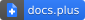
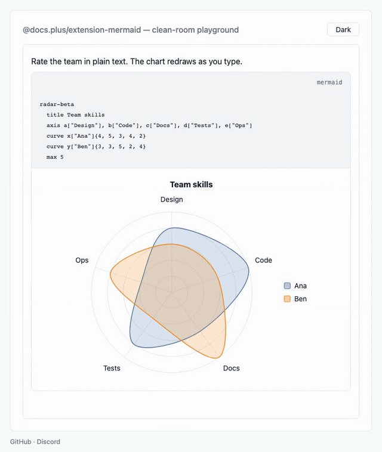
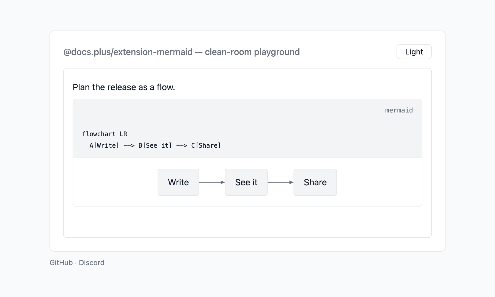
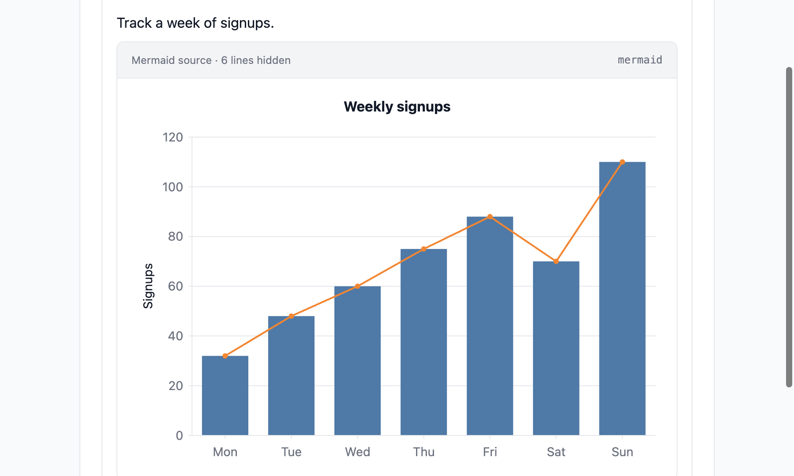
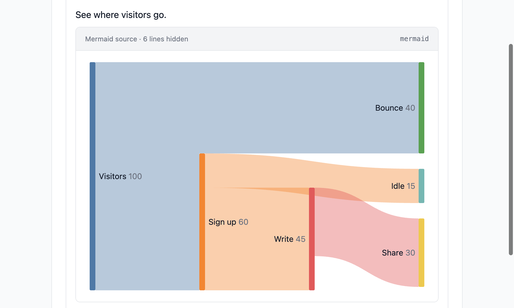
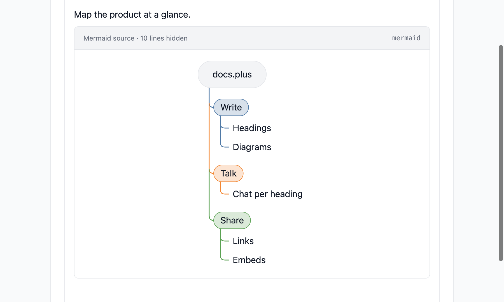
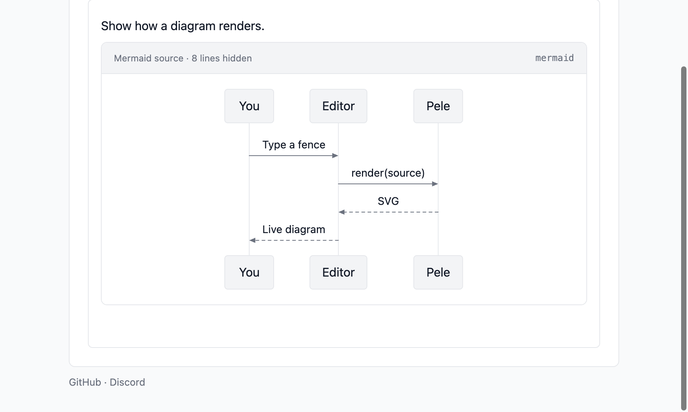

# @docs.plus/extension-mermaid

[](https://github.com/docs-plus/docs.plus)
[](https://www.npmjs.com/package/@docs.plus/extension-mermaid)
[](https://npmcharts.com/compare/@docs.plus/extension-mermaid)
[](https://www.npmjs.com/package/@docs.plus/extension-mermaid)
[](https://discord.gg/25JPG38J59)

<p align="center">
  <picture>
    <source media="(prefers-color-scheme: dark)" srcset="https://raw.githubusercontent.com/docs-plus/docs.plus/main/extensions/extension-mermaid/assets/demo-dark.gif">
    
  </picture>
</p>

Tiptap extension that draws Mermaid code blocks as live SVG diagrams. The source stays on top, and the diagram redraws under it as you type.

Diagrams are drawn by [Pele](https://pele.run), the Mermaid renderer by Steph Ango ([@kepano](https://x.com/kepano)), CEO of Obsidian. MIT licence.

[](https://stackblitz.com/github/docs-plus/docs.plus/tree/main/extensions/extension-mermaid/examples/vanilla?file=main.ts)

## Why use it

- **The diagram follows the text.** The SVG redraws 300 ms after you stop typing, for local and remote edits. A mistake names its line and column, and the last good diagram stays in view.
- **Charts, not only flowcharts.** Pele detects and draws 33 diagram types, such as sequence, Gantt, pie, radar, sankey, XY chart and mind map. See the [Gallery](#gallery).
- **Drawn by Pele, loaded on demand.** Your bundler emits Pele as separate chunks, and one chunk loads per diagram type. mermaid.js is not a dependency. Pele's speed claims and our own timing, with their limits, are in [About Pele](https://github.com/docs-plus/docs.plus/blob/main/extensions/extension-mermaid/docs/pele.md).
- **Size limits measured on real phones.** A diagram over 10,000 characters or 250 arrows (`edges`) shows a message instead of drawing. Larger ones took more than 200 ms on a real Android phone or iPhone. The numbers are in [Measured on real phones](https://github.com/docs-plus/docs.plus/blob/main/extensions/extension-mermaid/docs/pele.md#measured-on-real-phones).
- **Readers see the diagram, writers see both.** The **Hide source** button folds the text away. The `fold` option sets it up. Read-only editors start folded. Syntax and Copy sit beside it, in the head row above the source.
- **No new node, and a plain fence in storage.** A diagram is a standard `codeBlock` with `language: 'mermaid'`. The document holds a `mermaid` fence, as on GitHub, GitLab and Obsidian, and never the SVG. Removing the extension leaves plain code blocks. Yjs merges the source per character.
- **Light and dark from your page.** The default colours follow `color-scheme`. Pele's `--pele-*` variables, or the `theme` option, set your own.
- **Safe defaults, with one gap.** Pele escapes diagram text. Links and remote images are off, and size limits cap the work. The SVG is not sanitized unless you pass `sanitize`, so pass it for sources you do not trust.

## Install

```sh
npm install @docs.plus/extension-mermaid
```

Or use `pnpm add @docs.plus/extension-mermaid`, `yarn add @docs.plus/extension-mermaid`, or `bun add @docs.plus/extension-mermaid`.

Requires **`@tiptap/core` ^3.32.2** and **`@tiptap/pm` ^3.32.2** (Tiptap 3.x). They are peer dependencies. Some package managers do not install peers for you, so this line is always safe to run: `npm install @tiptap/core@^3.32.2 @tiptap/pm@^3.32.2`. Keep every `@tiptap/*` package in your app on the same version.

Upgrading from `2.2.0` to `2.3.0`? The Tiptap peer floor rose from `^3.31.3` to `^3.32.2`. Move `@tiptap/core`, `@tiptap/pm` and your other `@tiptap/*` packages first, then update this package. Most apps need no other change. Two things behave differently for an app with its own `codeBlock` node view:

- A plugin `nodeViews.codeBlock` that ranks below this one now gets every block that is not `mermaid`. Its `update` must return `false` when a block's language changes to or from `mermaid`.
- An app with its own `addNodeView` on `codeBlock` can now see the development warning. To draw diagrams there, call `mermaidNodeView`.

The [Changelog](https://github.com/docs-plus/docs.plus/blob/main/extensions/extension-mermaid/CHANGELOG.md) has the full list.

This package imports no React, Vue, or Next.js code. Use it from a plain page, Vite, React, Vue, Svelte, Next.js, Nuxt, or SvelteKit. Create the editor in the browser.

React Native has no DOM. Load the editor in a web view.

Installs one runtime dependency: [`pele`](https://www.npmjs.com/package/pele) (`1.8.0`, pinned exactly), the renderer. The package loads Pele with a dynamic `import()`, so your bundler emits it as separate chunks. Nothing loads from a CDN. For CSP, see [Content Security Policy](https://github.com/docs-plus/docs.plus/blob/main/extensions/extension-mermaid/docs/security.md#content-security-policy).

Import the stylesheet `@docs.plus/extension-mermaid/styles.css`. The fold control, the head and the actions need it.

## Quickstart

[](https://stackblitz.com/github/docs-plus/docs.plus/tree/main/extensions/extension-mermaid/examples/vanilla?file=main.ts)

Run this Quickstart in your browser first, with nothing to install. The app lives in [`examples/vanilla`](https://github.com/docs-plus/docs.plus/tree/main/extensions/extension-mermaid/examples/vanilla).

The snippet also imports `@tiptap/starter-kit`. Its `codeBlock` node holds each diagram. Add it with `npm install @tiptap/starter-kit@^3.32.2` when your app has none yet.

Your page needs `color-scheme: light dark` in its CSS, such as `:root { color-scheme: light dark; }`. Without it, diagrams keep the light colours in dark mode.

```ts
import { Editor } from '@tiptap/core'
import StarterKit from '@tiptap/starter-kit'
import { Mermaid } from '@docs.plus/extension-mermaid'
import '@docs.plus/extension-mermaid/styles.css'

// The page needs <div id="editor"></div> and `color-scheme: light dark`.
const editor = new Editor({ extensions: [StarterKit, Mermaid] })
editor.mount(document.querySelector('#editor')!)
editor.commands.setContent(
  '<pre><code class="language-mermaid">flowchart LR\n  A[Write] --> B[See it]</code></pre>'
)
```

You should see the source with a two-box flowchart under it. Edit the source, and the diagram redraws after you stop typing.

## Caveats

- **Only the exact language `mermaid` draws.** A fence tagged `Mermaid` with a capital M stays plain code. Markdown keeps all the text after the backticks as the language, so ` ```mermaid title ` stays plain code. In HTML, that text becomes two classes, and the parser reads only `language-mermaid`. So the same block becomes a diagram after an HTML round trip. This follows from how the two parsers read the language, not from this package. Tag the fence `mermaid` alone.
- **The editor needs a `codeBlock` node.** Without one, nothing draws and `insertMermaid` returns false.
- **A host `addNodeView` on `codeBlock` wins.** It replaces the diagram view, for example `CodeBlockLowlight.extend({ addNodeView })`. Call [`mermaidNodeView`](https://github.com/docs-plus/docs.plus/blob/main/extensions/extension-mermaid/docs/guide.md#keep-your-own-code-block-view) in that view to keep diagrams. In development, the console warns once per editor: `[extension-mermaid] Another node view owns codeBlock…`. The check reads `process.env.NODE_ENV`, so without a global `process` it stays off. The check changes only whether the warning shows. It never changes which view draws.
- **Among plugin views on `codeBlock`, the first one wins.** A higher extension `priority` comes first. At equal priority, the extension listed last comes first. So `extensions: [Mermaid, Other]` lets `Other` take every block, and no diagram draws. A plugin view is a `nodeViews.codeBlock` prop on a ProseMirror plugin. This view hands every block that is not `mermaid` to the next plugin view. A plugin view that comes before this one takes `mermaid` blocks too, so no diagram draws. In development, the console shows the same warning. To fix it, list `Mermaid` after the other extension, or give `Mermaid` a higher `priority`. Or call `mermaidNodeView` in that plugin view through a wrapper, as [Use it in a plugin view](https://github.com/docs-plus/docs.plus/blob/main/extensions/extension-mermaid/docs/guide.md#use-it-in-a-plugin-view) shows.
- **Without `styles.css`, the fold control, the head and the actions render unstyled, and Pele's own error box shows.** Add the stylesheet. Or set `fold: false`, `helpLink: false` and `copy: false`, and copy the three rules from [Without `styles.css`](https://github.com/docs-plus/docs.plus/blob/main/extensions/extension-mermaid/docs/guide.md#without-stylescss).
- **The default colours need `color-scheme`.** They use `light-dark()`. Set `color-scheme: light dark` on your page, or the light colours always show.
- **Pele has no time limit.** `limits` is the only cap on its work, so raise it with care. `edges` counts arrows in flowchart and agentflow (a Pele diagram type) only. See [Security](https://github.com/docs-plus/docs.plus/blob/main/extensions/extension-mermaid/docs/security.md).
- **The SVG is not sanitized by default.** Pass `sanitize` when sources come from people you do not trust. See [Sanitizing the SVG](https://github.com/docs-plus/docs.plus/blob/main/extensions/extension-mermaid/docs/security.md#sanitizing-the-svg).

The full list, with the reason for each, is in [Caveats](https://github.com/docs-plus/docs.plus/blob/main/extensions/extension-mermaid/docs/api.md#caveats).

## Common tasks

### Add a toolbar or slash item

```ts
editor.chain().focus().insertMermaid().run()
```

The command inserts a four-line flowchart and puts the caret at the end of the source. Gate the button with `editor.can().insertMermaid()`. It does not check that a diagram can draw. Read the active state with `editor.isActive('codeBlock', { language: 'mermaid' })`. See [Commands](https://github.com/docs-plus/docs.plus/blob/main/extensions/extension-mermaid/docs/api.md#commands).

Writers can also type ` ```mermaid ` and then a space or Enter. The code block input rule makes a diagram block, and it matches lowercase only. A Markdown `mermaid` fence loads as a diagram when your editor parses Markdown. This package does not load a Markdown parser. Install one with `npm install @tiptap/markdown@^3.32.2`, then add `Markdown` next to `Mermaid`:

````ts
import { Markdown } from '@tiptap/markdown'

const editor = new Editor({ extensions: [StarterKit, Mermaid, Markdown] })
editor.commands.setContent('```mermaid\nflowchart LR\n  A --> B\n```', { contentType: 'markdown' })
````

### Change the size limits

```ts
Mermaid.configure({ limits: { characters: 20000 } })
```

A missing field keeps its default, so `edges` stays 250 here. Each diagram block is checked on its own.

- `characters` is the source's JavaScript `length`, spaces and `accTitle` lines included. A source of exactly the limit draws. Most emoji count 2, a flag counts 4, and a family emoji counts 11. Measure with `source.length`.
- `edges` counts each link Pele draws. A chain `A --> B --> C` is 2. `A --> B & C` is 2, and `A & B --> C & D` is 4. `<-->`, `-.->`, `==>`, `---` and the invisible `~~~` count 1 each.
- Only flowchart and agentflow have an edge count. Agentflow is a Pele diagram type. Other types, such as sequence, have only the `characters` limit.
- A block over a limit shows "This diagram is too large to draw." and is never drawn. `onStateChange` reports `state: 'error'` with `error.code` `'limit'`. If the block drew before, the last good diagram stays, dimmed. The dimming needs `styles.css`, or the third rule in [Without `styles.css`](https://github.com/docs-plus/docs.plus/blob/main/extensions/extension-mermaid/docs/guide.md#without-stylescss).
- No limit covers the whole document. A limit has no `false` setting. `Infinity` lifts it, and `0` blocks every diagram. Pele has no time limit, so lift or raise a limit only for sources you trust.
- Pele has fixed caps of its own, such as the size of the drawn SVG. They also report `'limit'`, and `limits` does not change them.

See [Options](https://github.com/docs-plus/docs.plus/blob/main/extensions/extension-mermaid/docs/api.md#options).

### Sanitize the SVG

```ts
import DOMPurify from 'dompurify'

Mermaid.configure({
  sanitize: (svg) =>
    DOMPurify.sanitize(svg, {
      USE_PROFILES: { svg: true },
      ADD_ATTR: ['role'],
      FORBID_TAGS: ['style', 'a', 'image', 'use'],
      FORBID_ATTR: ['href', 'xlink:href'],
      RETURN_DOM_FRAGMENT: true
    })
})
```

`sanitize` must return a DOM `Node`, so keep `RETURN_DOM_FRAGMENT: true`. A returned string shows as plain text, not as a diagram. The package does not depend on DOMPurify. The attributes that must survive are listed in [Security](https://github.com/docs-plus/docs.plus/blob/main/extensions/extension-mermaid/docs/security.md#sanitizing-the-svg).

### Report slow renders and load errors

```ts
Mermaid.configure({
  onStateChange({ state, error, durationMs }) {
    if (state === 'load-error') console.warn('Mermaid renderer did not load', error?.message)
    if (durationMs !== null && durationMs > 200) console.warn('Slow diagram', durationMs)
  }
})
```

With the built-in view, a block shows a spinner under the source while Pele loads. After a `load-error`, it shows "Could not load the diagram renderer." and a **Try again** button. `durationMs` covers Pele plus the sanitizer. It is null for every state except `ready` and `error`. See [onStateChange](https://github.com/docs-plus/docs.plus/blob/main/extensions/extension-mermaid/docs/api.md#onstatechange).

## Gallery

Each block is a plain `mermaid` fence, drawn with the default colours. Each screenshot has a light and a dark version, and follows your system preference.

<details>
<summary><strong>Flowchart</strong> — source on top, diagram under it</summary>

<p align="center">
  <picture>
    <source media="(prefers-color-scheme: dark)" srcset="https://raw.githubusercontent.com/docs-plus/docs.plus/main/extensions/extension-mermaid/assets/preview-dark.png">
    
  </picture>
</p>

</details>

<details>
<summary><strong>XY chart</strong> — bars and a line on shared axes</summary>

<p align="center">
  <picture>
    <source media="(prefers-color-scheme: dark)" srcset="https://raw.githubusercontent.com/docs-plus/docs.plus/main/extensions/extension-mermaid/assets/xychart-dark.png">
    
  </picture>
</p>

</details>

<details>
<summary><strong>Sankey</strong> — flows between stages</summary>

<p align="center">
  <picture>
    <source media="(prefers-color-scheme: dark)" srcset="https://raw.githubusercontent.com/docs-plus/docs.plus/main/extensions/extension-mermaid/assets/sankey-dark.png">
    
  </picture>
</p>

</details>

<details>
<summary><strong>Mind map</strong> — an outline as branches</summary>

<p align="center">
  <picture>
    <source media="(prefers-color-scheme: dark)" srcset="https://raw.githubusercontent.com/docs-plus/docs.plus/main/extensions/extension-mermaid/assets/mindmap-dark.png">
    
  </picture>
</p>

</details>

<details>
<summary><strong>Sequence</strong> — messages between participants</summary>

<p align="center">
  <picture>
    <source media="(prefers-color-scheme: dark)" srcset="https://raw.githubusercontent.com/docs-plus/docs.plus/main/extensions/extension-mermaid/assets/sequence-dark.png">
    
  </picture>
</p>

</details>

## Documentation

| Guide                                                                                                      | What it covers                                                                                                          |
| ---------------------------------------------------------------------------------------------------------- | ----------------------------------------------------------------------------------------------------------------------- |
| [API reference](https://github.com/docs-plus/docs.plus/blob/main/extensions/extension-mermaid/docs/api.md) | Options, commands, states, `onStateChange`, fixed behaviour, class names, TypeScript exports, and the full caveats list |
| [Guide](https://github.com/docs-plus/docs.plus/blob/main/extensions/extension-mermaid/docs/guide.md)       | Theming, source folding, the view slot, accessible names, syntax highlighting, and your own code block view             |
| [Security](https://github.com/docs-plus/docs.plus/blob/main/extensions/extension-mermaid/docs/security.md) | Untrusted sources, limits, sanitizing the SVG, and CSP                                                                  |
| [About Pele](https://github.com/docs-plus/docs.plus/blob/main/extensions/extension-mermaid/docs/pele.md)   | What Pele is, how this package uses it, and the credit                                                                  |
| [Changelog](https://github.com/docs-plus/docs.plus/blob/main/extensions/extension-mermaid/CHANGELOG.md)    | Every release and its breaking changes                                                                                  |
| [For AI coding agents](https://cdn.jsdelivr.net/npm/@docs.plus/extension-mermaid/README.md)                | This README as plain Markdown for your agent. The docs are also on [Context7](https://context7.com/docs-plus/docs.plus) |

## Part of docs.plus

This extension is built for and maintained by [docs.plus](https://docs.plus). docs.plus is a free, real-time collaboration tool that lets communities organize knowledge hierarchically, with a chat thread on every heading. docs.plus runs these packages from source in production, so every release is exercised there before it reaches npm.

- Website: [docs.plus](https://docs.plus)
- Project README: [docs-plus/docs.plus](https://github.com/docs-plus/docs.plus#readme)
- Sibling extensions and recommended pairings: [extensions/README.md](https://github.com/docs-plus/docs.plus/blob/main/extensions/README.md)

## Contributing

Bug reports and PRs welcome. Setup, test commands, and the playground harness live in [CONTRIBUTING.md](https://github.com/docs-plus/docs.plus/blob/main/extensions/extension-mermaid/CONTRIBUTING.md).

## License

MIT — see [LICENSE](https://github.com/docs-plus/docs.plus/blob/main/LICENSE).
