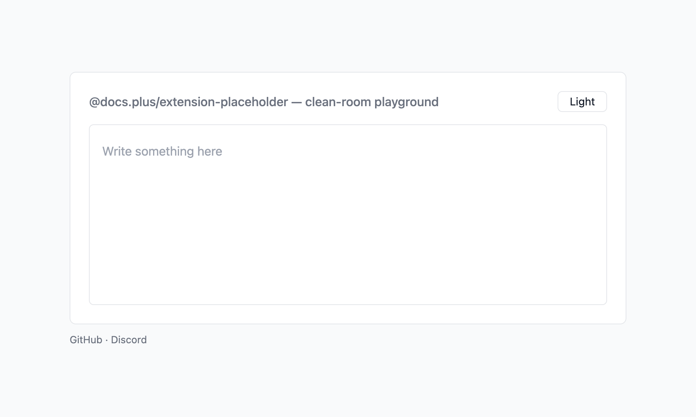

# @docs.plus/extension-placeholder

[](https://github.com/docs-plus/docs.plus)
[](https://www.npmjs.com/package/@docs.plus/extension-placeholder)
[](https://npmcharts.com/compare/@docs.plus/extension-placeholder)
[](https://www.npmjs.com/package/@docs.plus/extension-placeholder)
[](https://discord.gg/25JPG38J59)

<p align="center">
  <picture>
    <source media="(prefers-color-scheme: dark)" srcset="https://raw.githubusercontent.com/docs-plus/docs.plus/main/extensions/extension-placeholder/assets/preview-dark.png">
    
  </picture>
</p>

Tiptap placeholder extension that shows hint text in the empty textblock at the cursor. One hint shows at a time.

A textblock is a node that holds inline text, such as a paragraph or a heading.

[](https://stackblitz.com/github/docs-plus/docs.plus/tree/main/extensions/extension-placeholder/examples/vanilla?file=main.ts)

## Why use it

- **Nested blocks work with no full-document scan.** An empty paragraph inside a list item or blockquote gets the hint with no extra option. The extension walks up from the cursor, so the cost tracks nesting depth, not document length. Tiptap's built-in [Placeholder](https://tiptap.dev/docs/editor/extensions/functionality/placeholder) reaches a nested paragraph only with `includeChildren`. That mode scans the whole document at start, then each top-level block a change touches.
- **Migration starts with one import swap.** `placeholder`, `emptyNodeClass`, `emptyEditorClass` and `showOnlyWhenEditable` keep the built-in's names and defaults. The callback form also receives `parentName` and `doc`.
- **Metadata-only transactions skip the rebuild.** A transaction that changes neither the document nor the selection keeps the previous hint. An awareness ping in a collaborative editor is one example. With default options, the built-in re-runs the `placeholder` callback on every editor update.

Keep the built-in when you need a hint in every empty block at once (`showOnlyCurrent: false`). This package shows one hint, at the cursor.

## Install

```sh
npm install @docs.plus/extension-placeholder
```

Or use `pnpm add @docs.plus/extension-placeholder`, `yarn add @docs.plus/extension-placeholder`, or `bun add @docs.plus/extension-placeholder`.

Requires **`@tiptap/core` ^3.32.2** and **`@tiptap/pm` ^3.32.2**. That means Tiptap 3.32.2 or a later 3.x release. An earlier 3.x release does not meet the range.

This package imports no React, Vue, or Next.js code. Use it from a plain page, Vite, React, Vue, Svelte, Next.js, Nuxt, or SvelteKit. Create the editor in the browser.

React Native has no DOM. Load the editor in a web view.

Installs with no runtime dependencies.

Upgrading from `2.2.0` to `2.3.0`? No behavior changed. No option, callback field or class name changed either, so your `Placeholder.configure({ … })` call needs no edit. Only the peer floor moved. The peer floor is the lowest Tiptap version this package accepts. It rose from `^3.31.3` to `^3.32.2`. On Tiptap 3.31.x, your package manager reports a peer conflict at install. So move `@tiptap/core` and `@tiptap/pm` to 3.32.2 or later first. Then install every other `@tiptap/*` package, such as `@tiptap/starter-kit`, at the exact version of your `@tiptap/core`. The release is a minor because every docs.plus extension moves to 2.3.0 together. It adds no feature, and your code needs no change. See the [Changelog](https://github.com/docs-plus/docs.plus/blob/main/extensions/extension-placeholder/CHANGELOG.md).

To move from Tiptap's built-in Placeholder, see [Migrating from the built-in Placeholder](https://github.com/docs-plus/docs.plus/blob/main/extensions/extension-placeholder/docs/migration.md#migrating-from-the-built-in-placeholder).

## Quickstart

[](https://stackblitz.com/github/docs-plus/docs.plus/tree/main/extensions/extension-placeholder/examples/vanilla?file=main.ts)

Run this Quickstart in your browser first, with nothing to install. The app lives in [`examples/vanilla`](https://github.com/docs-plus/docs.plus/tree/main/extensions/extension-placeholder/examples/vanilla).

Register `Placeholder` in the extensions array and set the hint text. The host page needs one mount point: `<div id="editor"></div>`. The snippet also imports `@tiptap/starter-kit`. When your app has none yet, add it at the exact version of your `@tiptap/core`, for example `npm install @tiptap/starter-kit@3.32.2`.

```ts
import { Editor } from '@tiptap/core'
import StarterKit from '@tiptap/starter-kit'
import { Placeholder } from '@docs.plus/extension-placeholder'

const editor = new Editor({
  element: document.querySelector('#editor')!,
  extensions: [
    StarterKit,
    // StarterKit does not include a placeholder extension.
    // If your array already holds Tiptap's built-in Placeholder, remove it.
    // Register one placeholder extension, never both.
    Placeholder.configure({
      placeholder: 'Write something …'
    })
  ]
})
```

The package ships no CSS, so add this rule to your page to render the hint:

```css
.ProseMirror [data-placeholder]::before {
  content: attr(data-placeholder);
  color: #9ca3af;
  float: left;
  height: 0;
  pointer-events: none;
}
```

`float: left` and `height: 0` take the hint out of the line, so the caret stays at the start of the empty line. `pointer-events: none` lets a click on the hint reach the editor. Only `color` is a style choice.

You should see the hint `Write something …` in the empty editor as soon as the page loads. A new editor puts its cursor in the first paragraph, even before you click, and the hint does not need focus. Click in the editor and type a character, and the hint disappears. Press Enter, and the hint moves to the new empty paragraph.

## Caveats

- **Nothing renders without CSS.** The package ships no stylesheet, and the extension writes the hint text into a `data-placeholder` attribute. Add the rule in [Quickstart](#quickstart).
- **Two placeholder extensions collide.** This extension and Tiptap's built-in both register the name `placeholder`. Tiptap logs the warning `[tiptap warn]: Duplicate extension names found: ['placeholder']. This can lead to issues.`, and both plugins decorate the document.
- **`showOnlyCurrent`, `includeChildren` and `dataAttribute` do not exist.** TypeScript rejects them in a `.configure({ … })` literal. A plain JavaScript host gets no error and no warning, and the extension ignores the key. None of the three needs a replacement: the extension always shows one hint at the cursor, reaches nested textblocks, and writes `data-placeholder`. The option map in [Migrating from the built-in Placeholder](https://github.com/docs-plus/docs.plus/blob/main/extensions/extension-placeholder/docs/migration.md#migrating-from-the-built-in-placeholder) explains each one.
- **The callback runs only on a document or selection change.** Hint text from outside the document, i18n text for example, does not refresh on its own. Force a rebuild with `editor.view.dispatch(editor.state.tr.setSelection(editor.state.selection))`. Run it once, right after the outside text changes, for example after a language switch. This transaction changes no document content, so it adds no undo step.

The full list, with the reason for each, is in [Caveats](https://github.com/docs-plus/docs.plus/blob/main/extensions/extension-placeholder/docs/api.md#caveats).

## Common tasks

### Set a hint per textblock type

A string gives every textblock the same hint. A callback picks the hint per textblock. Either way, only the empty textblock at the cursor shows it.

```ts
Placeholder.configure({
  placeholder: ({ node, parentName }) => {
    if (node.type.name === 'heading') return "What's the title?"
    if (parentName === 'listItem') return 'List item'
    if (parentName === 'blockquote') return 'Quote'
    return 'Can you add some further context?'
  }
})
```

An empty paragraph inside a list item reports `node.type.name === 'paragraph'` and `parentName === 'listItem'`. A top-level paragraph reports `parentName === 'doc'`. For one hint per heading level, read `node.attrs.level`. A callback that returns `''` shows no hint in that textblock.

The callback also receives `pos`, `doc`, `hasAnchor` and `editor`. `pos` is the position of `node` in `doc`. Read `doc`, not `editor.state.doc`, because the callback runs before the editor commits the change. `hasAnchor` is always `true` here, because only the textblock at the cursor gets a hint. Each field is described in [`placeholder`](https://github.com/docs-plus/docs.plus/blob/main/extensions/extension-placeholder/docs/api.md#placeholder).

### Show the hint only in an empty document

While the whole document is empty, the extension adds the class `is-editor-empty` to the textblock that holds the hint. The `emptyEditorClass` option renames that class. A document of empty textblocks only counts as empty. The hint still sits in the textblock at the cursor, wherever that is. Swap the selector of the Quickstart rule for the selector below:

```css
.ProseMirror .is-editor-empty[data-placeholder]::before {
  content: attr(data-placeholder);
  color: #9ca3af;
  float: left;
  height: 0;
  pointer-events: none;
}
```

### Hide the hint when the editor has no focus

The extension has no focus option. To hide the hint while the editor has no focus, add this rule. It works apart from `showOnlyWhenEditable`, which hides the hint only while the editor is read-only.

```css
.ProseMirror:not(:focus-within) [data-placeholder]::before {
  content: none;
}
```

## Documentation

| Guide                                                                                                                                          | What it covers                                                                                                                                    |
| ---------------------------------------------------------------------------------------------------------------------------------------------- | ------------------------------------------------------------------------------------------------------------------------------------------------- |
| [API reference](https://github.com/docs-plus/docs.plus/blob/main/extensions/extension-placeholder/docs/api.md)                                 | Options, the `placeholder` callback, the full caveats list, and TypeScript exports                                                                |
| [Guide](https://github.com/docs-plus/docs.plus/blob/main/extensions/extension-placeholder/docs/guide.md)                                       | How it works, Styling and class names, and collaborative editing                                                                                  |
| [Migrating from the built-in Placeholder](https://github.com/docs-plus/docs.plus/blob/main/extensions/extension-placeholder/docs/migration.md) | Moving from Tiptap's built-in Placeholder: option map and behavior differences                                                                    |
| [Changelog](https://github.com/docs-plus/docs.plus/blob/main/extensions/extension-placeholder/CHANGELOG.md)                                    | Every release and its breaking changes                                                                                                            |
| [For AI coding agents](https://cdn.jsdelivr.net/npm/@docs.plus/extension-placeholder/README.md)                                                | The README of the latest npm release, as plain Markdown for your agent. The docs are also on [Context7](https://context7.com/docs-plus/docs.plus) |

## Part of docs.plus

This extension is built for and maintained by [docs.plus](https://docs.plus). docs.plus is a free, real-time collaboration tool that lets communities organize knowledge hierarchically, with a chat thread on every heading. docs.plus runs these packages from source in production, so every release is exercised there before it reaches npm.

- Website: [docs.plus](https://docs.plus)
- Project README: [docs-plus/docs.plus](https://github.com/docs-plus/docs.plus#readme)
- Sibling extensions and recommended pairings: [extensions/README.md](https://github.com/docs-plus/docs.plus/blob/main/extensions/README.md)

## Contributing

Bug reports and PRs welcome. Setup, test commands, and the playground harness live in [CONTRIBUTING.md](https://github.com/docs-plus/docs.plus/blob/main/extensions/extension-placeholder/CONTRIBUTING.md).

## License

MIT — see [LICENSE](https://github.com/docs-plus/docs.plus/blob/main/LICENSE).
